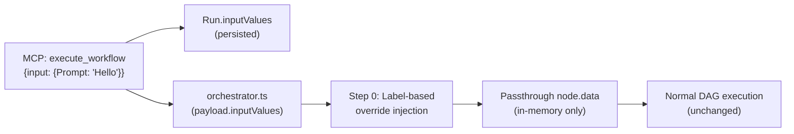

# Parameterized Workflow Execution — Walkthrough

## Summary

Implemented the ability for external consumers (MCP tools, API) to invoke workflows with custom input values for passthrough nodes, while keeping workflow templates immutable. Passthrough nodes (Text, Image, Video) now serve as the "API surface" of a workflow — their values can be overridden per-execution via a `label → value` contract.

## Architecture



## Changes Made

### 1. Schema — `prisma/schema.prisma`
```diff:schema.prisma
generator client {
  provider        = "prisma-client-js"
  previewFeatures = ["driverAdapters"]
}

datasource db {
  provider = "postgresql"
}

model User {
  id        String         @id // Clerk User ID
  credits   Int            @default(0) // Microcredit balance (1,000,000 = $1.00)
  workflows Workflow[]
  runs      Run[]
  ledger    CreditLedger[]
  createdAt DateTime       @default(now())
  updatedAt DateTime       @updatedAt
}

model Workflow {
  id          String   @id @default(uuid())
  name        String
  description String?
  nodes       Json     // React Flow nodes state
  edges       Json     // React Flow edges state
  userId      String
  user        User     @relation(fields: [userId], references: [id])
  runs        Run[]
  createdAt   DateTime @default(now())
  updatedAt   DateTime @updatedAt
}

model Run {
  id          String         @id @default(uuid())
  workflowId  String
  workflow    Workflow        @relation(fields: [workflowId], references: [id], onDelete: Cascade)
  userId      String
  user        User            @relation(fields: [userId], references: [id])
  scope       String          // 'FULL', 'PARTIAL', 'SINGLE'
  status      String          // 'PENDING', 'RUNNING', 'SUCCESS', 'FAILED', 'PARTIAL'
  triggerId   String?         // Trigger.dev Run/Execution ID for cancellations
  durationMs  Int?
  completedAt DateTime?       // Set when run reaches a terminal status
  nodeRuns    NodeRun[]
  ledger      CreditLedger[]
  createdAt   DateTime        @default(now())

  @@index([userId, createdAt(sort: Desc)])
  @@index([workflowId])
}

model NodeRun {
  id           String         @id @default(uuid())
  runId        String
  run          Run            @relation(fields: [runId], references: [id], onDelete: Cascade)
  nodeId       String
  nodeType     String
  status       String         // 'PENDING', 'RUNNING', 'SUCCESS', 'FAILED'
  inputs       Json?
  outputs      Json?
  error        String?
  providerUsed String?        // e.g. "fal", "ffmpeg", "gemini"
  creditsUsed  Int            @default(0)
  durationMs   Int?
  createdAt    DateTime       @default(now())
  ledger       CreditLedger[]

  @@index([runId, nodeId])
}

model CreditLedger {
  id            String   @id @default(cuid())
  userId        String
  user          User     @relation(fields: [userId], references: [id])
  delta         Int      // Positive = top-up, negative = spend
  reason        String   // e.g. "node:seedream-4.5", "reserve:run", "settle:node", "topup", "refund"
  workflowRunId String?
  run           Run?     @relation(fields: [workflowRunId], references: [id])
  nodeRunId     String?
  nodeRun       NodeRun? @relation(fields: [nodeRunId], references: [id])
  createdAt     DateTime @default(now())

  @@index([userId, createdAt(sort: Desc)])
  @@index([workflowRunId])
  @@index([nodeRunId])
}
===
generator client {
  provider        = "prisma-client-js"
  previewFeatures = ["driverAdapters"]
}

datasource db {
  provider = "postgresql"
}

model User {
  id        String         @id // Clerk User ID
  credits   Int            @default(0) // Microcredit balance (1,000,000 = $1.00)
  workflows Workflow[]
  runs      Run[]
  ledger    CreditLedger[]
  createdAt DateTime       @default(now())
  updatedAt DateTime       @updatedAt
}

model Workflow {
  id          String   @id @default(uuid())
  name        String
  description String?
  nodes       Json     // React Flow nodes state
  edges       Json     // React Flow edges state
  userId      String
  user        User     @relation(fields: [userId], references: [id])
  runs        Run[]
  createdAt   DateTime @default(now())
  updatedAt   DateTime @updatedAt
}

model Run {
  id          String         @id @default(uuid())
  workflowId  String
  workflow    Workflow        @relation(fields: [workflowId], references: [id], onDelete: Cascade)
  userId      String
  user        User            @relation(fields: [userId], references: [id])
  scope       String          // 'FULL', 'PARTIAL', 'SINGLE'
  status      String          // 'PENDING', 'RUNNING', 'SUCCESS', 'FAILED', 'PARTIAL'
  inputValues Json?           // Label→value overrides for parameterized execution
  triggerId   String?         // Trigger.dev Run/Execution ID for cancellations
  durationMs  Int?
  completedAt DateTime?       // Set when run reaches a terminal status
  nodeRuns    NodeRun[]
  ledger      CreditLedger[]
  createdAt   DateTime        @default(now())

  @@index([userId, createdAt(sort: Desc)])
  @@index([workflowId])
}

model NodeRun {
  id           String         @id @default(uuid())
  runId        String
  run          Run            @relation(fields: [runId], references: [id], onDelete: Cascade)
  nodeId       String
  nodeType     String
  status       String         // 'PENDING', 'RUNNING', 'SUCCESS', 'FAILED'
  inputs       Json?
  outputs      Json?
  error        String?
  providerUsed String?        // e.g. "fal", "ffmpeg", "gemini"
  creditsUsed  Int            @default(0)
  durationMs   Int?
  createdAt    DateTime       @default(now())
  ledger       CreditLedger[]

  @@index([runId, nodeId])
}

model CreditLedger {
  id            String   @id @default(cuid())
  userId        String
  user          User     @relation(fields: [userId], references: [id])
  delta         Int      // Positive = top-up, negative = spend
  reason        String   // e.g. "node:seedream-4.5", "reserve:run", "settle:node", "topup", "refund"
  workflowRunId String?
  run           Run?     @relation(fields: [workflowRunId], references: [id])
  nodeRunId     String?
  nodeRun       NodeRun? @relation(fields: [nodeRunId], references: [id])
  createdAt     DateTime @default(now())

  @@index([userId, createdAt(sort: Desc)])
  @@index([workflowRunId])
  @@index([nodeRunId])
}
```

Added `inputValues Json?` to the `Run` model. This nullable column stores the label→value overrides for each execution. Existing runs are unaffected.

### 2. Type System — `lib/nodes/exposed-inputs.ts` *(NEW)*
```diff:exposed-inputs.ts
===
// ============================================================================
// lib/nodes/exposed-inputs.ts — Exposed Input Discovery for Parameterized Execution
// ============================================================================
//
// Provides the ExposedInput interface and getExposedInputs() utility that
// scans a workflow's node array and surfaces all passthrough nodes as
// overridable parameters. This is the public API surface for parameterized
// workflow execution — MCP tools, tRPC queries, and future UI all consume
// this function.
//
// RESOLUTION KEY: node.data.label (NOT nodeId)
// This ensures stability across workflow copies and node rearrangements.
// If a label is not set, falls back to the node type name (e.g., "text").
//
// DESIGN DECISIONS:
//   1. All passthrough nodes are treated as exposable (no opt-in toggle yet)
//   2. Multiple nodes with the same label are all surfaced (deduped by label)
//   3. The dataKey comes from passthroughMapping — the first key is primary
// ============================================================================

import type { NodeConfig } from "./types";

// ---------------------------------------------------------------------------
// ExposedInput — describes a single overridable parameter in a workflow
// ---------------------------------------------------------------------------
export interface ExposedInput {
  /** Node label (from node.data.label) — the resolution key for overrides */
  label: string;
  /** Node type identifier (e.g., "text", "image", "video") */
  nodeType: string;
  /** The data key that holds the overridable value (e.g., "text", "url") */
  dataKey: string;
  /** Current default value from the workflow template */
  defaultValue: unknown;
  /** Description of what this input does */
  description: string;
}

// ---------------------------------------------------------------------------
// Registry-compatible interface — avoids importing the full NodeRegistry
// class, allowing this module to be used in MCP (ESM) and tRPC contexts.
// ---------------------------------------------------------------------------
export interface RegistryLike {
  get(id: string): Pick<NodeConfig, "isPassthrough" | "passthroughMapping" | "description"> | undefined;
}

// ---------------------------------------------------------------------------
// getExposedInputs — extract all parameterizable inputs from a workflow
// ---------------------------------------------------------------------------
/**
 * Scans the workflow's node array and extracts all passthrough nodes as
 * ExposedInput descriptors. Consumers use these to discover which parameters
 * a workflow accepts and what their current default values are.
 *
 * @param nodes  - The workflow's deserialized nodes array (from Workflow.nodes)
 * @param registry - A registry-like object that can look up NodeConfig by type
 * @returns Array of ExposedInput descriptors, one per passthrough data key
 */
export function getExposedInputs(
  nodes: Array<{ id: string; type?: string; data: Record<string, unknown> }>,
  registry: RegistryLike,
): ExposedInput[] {
  const exposed: ExposedInput[] = [];

  for (const node of nodes) {
    if (!node.type) continue;

    const config = registry.get(node.type);
    if (!config?.isPassthrough || !config.passthroughMapping) continue;

    // Label resolution: node.data.label (set by manage_node MCP tool)
    // falls back to the node type string (e.g., "text")
    const label = (node.data.label as string) || node.type;

    for (const dataKey of Object.keys(config.passthroughMapping)) {
      exposed.push({
        label,
        nodeType: node.type,
        dataKey,
        defaultValue: node.data[dataKey] ?? "",
        description: config.description,
      });
    }
  }

  return exposed;
}
```

New module containing:
- **`ExposedInput`** interface — describes a single overridable parameter (label, nodeType, dataKey, defaultValue, description)
- **`getExposedInputs()`** function — scans a workflow's nodes array and extracts all passthrough nodes as parameter descriptors
- **`RegistryLike`** interface — decouples from the full NodeRegistry class for cross-context compatibility

### 3. Orchestrator — `src/trigger/orchestrator.ts`
```diff:orchestrator.ts
// ============================================================================
// src/trigger/orchestrator.ts — Config-Driven DAG Executor
// ============================================================================
//
// This is the core execution engine for NextFlow workflows. It receives a
// serialized DAG (nodes + edges), topologically sorts them into parallel
// execution layers, then dispatches each node using the NodeRegistry —
// completely eliminating hardcoded if/else branching.
//
// EXECUTION MODEL:
//   1. Build a topological sort → produce parallel "layers"
//   2. For each layer, iterate nodes and classify them:
//      a. PASSTHROUGH nodes (text, image, video) → resolve immediately
//         via registry.resolvePassthrough() — no Trigger.dev dispatch
//      b. ASYNC nodes (llm, crop, extract, ...) → resolve their endpoint
//         via registry.resolveEndpoint() → batch dispatch to Trigger.dev
//   3. After each batch completes, map raw provider outputs back to
//      node output keys via registry.mapOutput()
//   4. Store all intermediate results in nodeOutputs for downstream wiring
//   5. Deduct actual credits post-completion via Postgres FOR UPDATE txn
//
// ARCHITECTURAL INVARIANT (MEMORY.md Rule 2):
//   This orchestrator is NODE-TYPE-AGNOSTIC. It never inspects node.type
//   to decide what to do. All dispatch logic lives in the NodeConfig's
//   providers[] array, resolved dynamically by the registry.
//
// CREDIT DEDUCTION:
//   Block-on-estimate at tRPC level (pre-check), deduct-on-completion here.
//   Uses SELECT ... FOR UPDATE to prevent double-spend race conditions.
//   DB failure in credit deduction does NOT crash the orchestrator.
// ============================================================================

import { logger, task, batch, metadata } from "@trigger.dev/sdk/v3";
import { prisma } from "../../lib/db";
import { nodeRegistry } from "../../lib/nodes/registry";
import { deductCredits } from "../../lib/credits/credit-service";

// Ensure all node configs are registered before execution begins.
// This import triggers the side-effect of calling nodeRegistry.registerAll().
import "../../lib/nodes/configs";

// ── DAG Orchestration Task ──────────────────────────────────────────────────

export const orchestrateWorkflow = task({
  machine: {
    preset: "large-2x",
  },
  id: "orchestrate-workflow",
  retry: {
    maxAttempts: 1, // DO NOT RETRY THE ORCHESTRATOR. Let individual nodes retry.
  },
  run: async (payload: {
    runId: string;
    userId: string;
    nodes: any[];
    edges: any[];
    startTime?: number;
  }) => {
    logger.info("Orchestrating Workflow DAG", { runId: payload.runId });

    const { runId, userId, nodes, edges } = payload;
    const executionStart = payload.startTime || Date.now();

    // Realtime metadata — streamed to the client via useRealtimeRun.
    // Kept in local maps and flushed to Trigger.dev metadata on every transition.
    const rtStatuses: Record<string, string> = {};
    const rtOutputs: Record<string, Record<string, unknown>> = {};

    function emitNodeStatus(
      nodeId: string,
      status: string,
      outputs?: Record<string, unknown>
    ) {
      rtStatuses[nodeId] = status;
      metadata.set("nodeStatuses", JSON.parse(JSON.stringify(rtStatuses)));
      if (outputs) {
        rtOutputs[nodeId] = outputs;
        metadata.set("nodeOutputs", JSON.parse(JSON.stringify(rtOutputs)));
      }
    }

    // ── Step 1: Topological Sort ──────────────────────────────────────────
    // Build adjacency list + in-degree map for Kahn's algorithm.
    // Produces execution "layers" where all nodes in a layer can run in
    // parallel because their upstream dependencies have already resolved.

    const adjList = new Map<string, string[]>();
    const inDegree = new Map<string, number>();

    for (const n of nodes) {
      adjList.set(n.id, []);
      inDegree.set(n.id, 0);
    }

    for (const e of edges) {
      adjList.get(e.source)?.push(e.target);
      if (inDegree.has(e.target)) {
        inDegree.set(e.target, inDegree.get(e.target)! + 1);
      }
    }

    // Seed the queue with root nodes (in-degree 0)
    let queue: string[] = [];
    inDegree.forEach((degree, nodeId) => {
      if (degree === 0) queue.push(nodeId);
    });

    // BFS to produce parallel execution layers
    const layers: string[][] = [];
    while (queue.length > 0) {
      const nextQueue: string[] = [];
      const currentLayer: string[] = [];

      for (const nodeId of queue) {
        currentLayer.push(nodeId);
        for (const neighbor of adjList.get(nodeId) || []) {
          inDegree.set(neighbor, inDegree.get(neighbor)! - 1);
          if (inDegree.get(neighbor) === 0) nextQueue.push(neighbor);
        }
      }

      layers.push(currentLayer);
      queue = nextQueue;
    }

    // Cycle detection — if we didn't process all nodes, there's a cycle
    if (layers.flat().length !== nodes.length) {
      logger.error("Cycle detected in DAG", {
        processed: layers.flat().length,
        total: nodes.length,
      });
      await updateRunStatus(runId, "FAILED", Date.now() - executionStart);
      return;
    }

    logger.info("DAG layers calculated", { layerCount: layers.length, layers });

    // Credit pre-check happens in the tRPC layer (estimateWorkflowCost + getBalance).
    // Actual deduction happens post-completion inside the batch result loop below.

    // ── Step 2: Layer-by-Layer Execution ───────────────────────────────────
    // nodeOutputs accumulates the resolved output of every executed node.
    // Downstream nodes read their inputs from this map via edge wiring.

    const nodeOutputs = new Map<string, Record<string, unknown>>();

    try {
      for (let i = 0; i < layers.length; i++) {
        const layer = layers[i];
        logger.info(`Executing layer ${i + 1}/${layers.length}`, { nodes: layer });

        // Collect batch items for async (non-passthrough) nodes in this layer
        const batchItems: { id: string; payload: Record<string, unknown> }[] = [];
        // Track metadata per-node for timing, result mapping, and credit deduction
        const layerMeta: Record<string, {
          nodeStart: number;
          finalInputs: Record<string, unknown>;
          endpointId: string | null;
          providerId: string | null;
        }> = {};
        // Track which nodeIds correspond to batch items (ordered)
        const asyncNodeIds: string[] = [];

        for (const nodeId of layer) {
          const nodeStart = Date.now();
          const node = nodes.find((n: any) => n.id === nodeId);
          if (!node) continue;

          // ── Wire upstream outputs into this node's inputs ──────────────
          // For each incoming edge, pull the relevant output field from the
          // source node's resolved outputs and assign it to the target handle.
          const incomingEdges = edges.filter((e: any) => e.target === nodeId);
          const inputs: Record<string, unknown> = {};

          for (const edge of incomingEdges) {
            const sourceOutput = nodeOutputs.get(edge.source);
            if (!sourceOutput || !edge.targetHandle) continue;

            // ── Resolve the value from the source node's outputs ──────────
            // The sourceHandle should match a key in sourceOutput. However,
            // legacy edges may reference old handle IDs (e.g., "output") that
            // no longer match the config-driven output keys (e.g., "text").
            //
            // Lookup chain:
            //   1. Exact match: sourceOutput[edge.sourceHandle]
            //   2. Single-output fallback: if the source has only one output
            //      key and the handle didn't match, use that single value
            //      (covers legacy "output" → config "text" migration)
            let value: unknown;
            if (edge.sourceHandle && edge.sourceHandle in sourceOutput) {
              // Direct match — config handle IDs align
              value = sourceOutput[edge.sourceHandle];
            } else {
              // Fallback — the source node likely has only one output.
              // Use its first (and only) value regardless of key name.
              const outputKeys = Object.keys(sourceOutput);
              if (outputKeys.length > 0) {
                value = sourceOutput[outputKeys[0]];
                logger.info(`Edge fallback: "${edge.sourceHandle}" not in source outputs [${outputKeys}], using "${outputKeys[0]}"`, {
                  edgeId: edge.id,
                  source: edge.source,
                  target: edge.target,
                });
              }
            }

            // Skip if we couldn't resolve any value
            if (value === undefined) continue;

            // Multi-value inputs (e.g., "images") aggregate into arrays
            const targetConfig = nodeRegistry.get(node.type);
            const targetInput = targetConfig?.inputs.find(
              (inp) => inp.key === edge.targetHandle
            );

            if (targetInput?.multi) {
              // Track values by source node ID for reordering support
              const orderKey = `_multiSources_${edge.targetHandle}`;
              if (!inputs[orderKey]) {
                inputs[orderKey] = [] as Array<{ sourceId: string; value: unknown }>;
              }
              (inputs[orderKey] as Array<{ sourceId: string; value: unknown }>).push({
                sourceId: edge.source,
                value,
              });
            } else {
              inputs[edge.targetHandle] = value;
            }
          }

          // ── Reorder multi-inputs using _inputOrder ──────────────────────
          // The UI stores node.data._inputOrder[handleKey] as an ordered array
          // of source node IDs. Use that order when building the final arrays.
          const inputOrder = (node.data?._inputOrder as Record<string, string[]>) || {};

          for (const key of Object.keys(inputs)) {
            if (!key.startsWith("_multiSources_")) continue;
            const handleKey = key.replace("_multiSources_", "");
            const tracked = inputs[key] as Array<{ sourceId: string; value: unknown }>;
            const savedOrder = inputOrder[handleKey];

            let orderedValues: unknown[];
            if (savedOrder && savedOrder.length > 0) {
              // Reorder tracked values according to savedOrder
              const bySource = new Map<string, unknown>();
              for (const entry of tracked) {
                bySource.set(entry.sourceId, entry.value);
              }
              orderedValues = [];
              // First: values in the saved order
              for (const sourceId of savedOrder) {
                if (bySource.has(sourceId)) {
                  orderedValues.push(bySource.get(sourceId));
                  bySource.delete(sourceId);
                }
              }
              // Then: any remaining values not in the saved order (newly added)
              for (const remaining of bySource.values()) {
                orderedValues.push(remaining);
              }
            } else {
              // No saved order — use edge iteration order (original behavior)
              orderedValues = tracked.map((t) => t.value);
            }

            inputs[handleKey] = orderedValues;
            delete inputs[key]; // Clean up tracking key
          }

          // Merge node.data (user-entered values) with wired upstream values.
          // Upstream connections take precedence over static data.
          const finalInputs: Record<string, unknown> = { ...node.data, ...inputs };

          // Sanitize any array inputs to remove undefined/null/empty strings.
          // This prevents PrismaClientValidationError when empty connection
          // ports inject undefined values into array fields (like 'images').
          for (const key of Object.keys(finalInputs)) {
            if (Array.isArray(finalInputs[key])) {
              finalInputs[key] = (finalInputs[key] as any[]).filter(
                (val) => val !== undefined && val !== null && val !== ""
              );
            }
          }

          // Strip internal UI metadata (e.g., _inputOrder) from task payloads
          for (const key of Object.keys(finalInputs)) {
            if (key.startsWith("_")) {
              delete finalInputs[key];
            }
          }

          logger.info(`Processing node ${node.type} (${nodeId})`, { finalInputs });

          // ── Runtime Zod Validation of Merged Inputs ─────────────────────
          // The full payload (static + upstream) is now assembled. Validate
          // against the complete schema — at this point, all required fields
          // should be present. If upstream hallucinated bad data or a source
          // node failed, this catches it. Marks the node FAILED without
          // crashing the batch (MEMORY.md: single-node failure → PARTIAL).
          if (node.type && nodeRegistry.has(node.type)) {
            const inputSchema = nodeRegistry.getInputSchema(node.type);
            const parseResult = inputSchema.safeParse(finalInputs);
            if (!parseResult.success) {
              const issues = parseResult.error.issues
                .map((iss: any) => `${iss.path.join(".")}: ${iss.message}`)
                .join("; ");
              const errMsg = `Input validation failed: ${issues}`;
              logger.warn(`Node ${nodeId} failed runtime input validation`, {
                nodeType: node.type,
                issues: parseResult.error.issues,
              });
              await updateNodeRun(
                runId, nodeId, "FAILED",
                finalInputs, null, errMsg,
                Date.now() - nodeStart
              );
              emitNodeStatus(nodeId, "FAILED");
              continue;
            }

            // Strictly isolate inputs by reassigning to the Zod-stripped validated object.
            // This prevents outputs (e.g. `result`, `result_text`) from `node.data`
            // from leaking into task payloads.
            //
            // IMPORTANT: Only strip for non-passthrough nodes. Passthrough nodes
            // store their data in node.data fields (e.g. `url`) that are NOT in
            // the input schema — stripping would destroy them.
            const config = nodeRegistry.get(node.type);
            if (!config?.isPassthrough) {
              for (const key of Object.keys(finalInputs)) {
                delete finalInputs[key];
              }
              Object.assign(finalInputs, parseResult.data);
            }

            // ── Dynamic Element Handle Assembly ────────────────────────────
            // For nodes with allowDynamicHandles that have element_N_frontal /
            // element_N_ref_M keys (e.g., Kling O1), reassemble them into the
            // structured elements[] array expected by the task.
            // This runs after Zod validation (.passthrough() preserves dynamic
            // keys) and before endpoint resolution maps inputs to the payload.
            if (config?.allowDynamicHandles) {
              const elementMap = new Map<number, {
                frontal_image_url: string;
                reference_image_urls: string[];
              }>();

              for (const key of Object.keys(finalInputs)) {
                // Match element_N_frontal
                const frontalMatch = key.match(/^element_(\d+)_frontal$/);
                if (frontalMatch) {
                  const idx = parseInt(frontalMatch[1], 10);
                  if (!elementMap.has(idx)) {
                    elementMap.set(idx, { frontal_image_url: "", reference_image_urls: [] });
                  }
                  const val = finalInputs[key];
                  if (typeof val === "string" && val.length > 0) {
                    elementMap.get(idx)!.frontal_image_url = val;
                  }
                  delete finalInputs[key];
                  continue;
                }

                // Match element_N_ref_M
                const refMatch = key.match(/^element_(\d+)_ref_(\d+)$/);
                if (refMatch) {
                  const idx = parseInt(refMatch[1], 10);
                  const refIdx = parseInt(refMatch[2], 10);
                  if (!elementMap.has(idx)) {
                    elementMap.set(idx, { frontal_image_url: "", reference_image_urls: [] });
                  }
                  const val = finalInputs[key];
                  if (typeof val === "string" && val.length > 0) {
                    const refs = elementMap.get(idx)!.reference_image_urls;
                    // Ensure the array is large enough
                    while (refs.length <= refIdx) refs.push("");
                    refs[refIdx] = val;
                  }
                  delete finalInputs[key];
                  continue;
                }
              }

              // If we found any dynamic element keys, build the elements array
              if (elementMap.size > 0) {
                const sortedIndices = Array.from(elementMap.keys()).sort((a, b) => a - b);
                const assembledElements = sortedIndices.map((idx) => {
                  const el = elementMap.get(idx)!;
                  // Filter out empty reference URLs
                  el.reference_image_urls = el.reference_image_urls.filter((u) => u.length > 0);
                  return el;
                });

                // Merge with existing elements array (from manual UI input) if present
                const existingElements = finalInputs.elements;
                if (Array.isArray(existingElements) && existingElements.length > 0) {
                  // Dynamic handle values override matching indices, append new ones
                  for (let i = 0; i < assembledElements.length; i++) {
                    const assembled = assembledElements[i];
                    if (i < existingElements.length) {
                      // Override only if dynamic handle had a value
                      if (assembled.frontal_image_url) {
                        existingElements[i].frontal_image_url = assembled.frontal_image_url;
                      }
                      if (assembled.reference_image_urls.length > 0) {
                        // Merge references: override matching indices
                        for (let r = 0; r < assembled.reference_image_urls.length; r++) {
                          if (assembled.reference_image_urls[r]) {
                            existingElements[i].reference_image_urls[r] =
                              assembled.reference_image_urls[r];
                          }
                        }
                      }
                    } else {
                      existingElements.push(assembled);
                    }
                  }
                  finalInputs.elements = existingElements;
                } else {
                  finalInputs.elements = assembledElements;
                }

                logger.info("Assembled dynamic element handles into elements[]", {
                  nodeId,
                  elementCount: (finalInputs.elements as unknown[]).length,
                });
              }
            }
          }

          await updateNodeRun(runId, nodeId, "RUNNING", finalInputs, null, null);
          emitNodeStatus(nodeId, "RUNNING");

          // ── Classify: Passthrough vs Async ──────────────────────────────
          // The registry decides — we never inspect node.type ourselves.

          const passthroughOutput = nodeRegistry.resolvePassthrough(
            node.type,
            finalInputs
          );

          if (passthroughOutput !== null) {
            nodeOutputs.set(nodeId, passthroughOutput);
            await updateNodeRun(
              runId, nodeId, "SUCCESS",
              finalInputs, passthroughOutput, null,
              Date.now() - nodeStart
            );
            emitNodeStatus(nodeId, "SUCCESS", passthroughOutput);
            layerMeta[nodeId] = { nodeStart, finalInputs, endpointId: null, providerId: null };
            continue;
          }

          // ASYNC: resolve the provider endpoint from the registry
          const resolved = nodeRegistry.resolveEndpoint(node.type, finalInputs);

          if (!resolved) {
            const errMsg = `No endpoint resolved for node type "${node.type}"`;
            logger.warn(errMsg, { nodeId });
            await updateNodeRun(
              runId, nodeId, "FAILED",
              finalInputs, null, errMsg,
              Date.now() - nodeStart
            );
            emitNodeStatus(nodeId, "FAILED");
            continue;
          }

          // Queue for batch dispatch
          batchItems.push({ id: resolved.taskId, payload: resolved.payload });
          asyncNodeIds.push(nodeId);
          layerMeta[nodeId] = {
            nodeStart,
            finalInputs,
            endpointId: resolved.endpointId,
            providerId: resolved.providerId,
          };
        }

        // ── Batch Dispatch ────────────────────────────────────────────────
        // All async nodes in this layer fire in parallel via Trigger.dev's
        // batch.triggerAndWait. Results come back in the same order.

        if (batchItems.length > 0) {
          logger.info(
            `Dispatching ${batchItems.length} async tasks in layer ${i + 1}...`
          );

          try {
            const batchResult = await batch.triggerAndWait<any>(batchItems);

            for (let j = 0; j < asyncNodeIds.length; j++) {
              const nodeId = asyncNodeIds[j];
              const result = batchResult.runs[j];
              const { nodeStart, finalInputs, endpointId, providerId } = layerMeta[nodeId];
              const node = nodes.find((n: any) => n.id === nodeId);

              if (result.ok) {
                // Map raw provider output → node output keys via registry
                const rawOutput = result.output as Record<string, unknown>;
                const mappedOutput = node?.type && endpointId
                  ? nodeRegistry.mapOutput(node.type, endpointId, rawOutput)
                  : rawOutput;

                nodeOutputs.set(nodeId, mappedOutput);

                // ── Credit Deduction (post-completion) ─────────────────
                // Calculate actual cost from the provider response and write
                // a single negative ledger entry for this node.
                let creditsUsed = 0;
                if (node?.type) {
                  try {
                    creditsUsed = nodeRegistry.calculateCredits(
                      node.type,
                      finalInputs,
                      rawOutput
                    );

                    const nodeRun = await prisma.nodeRun.findFirst({
                      where: { runId, nodeId },
                      select: { id: true },
                    });
                    if (nodeRun && creditsUsed > 0) {
                      await deductCredits(
                        userId,
                        runId,
                        nodeRun.id,
                        creditsUsed,
                        node.type
                      );
                    }
                    logger.info("Credits deducted", {
                      nodeId,
                      nodeType: node.type,
                      creditsUsed,
                    });
                  } catch (creditErr: any) {
                    logger.error("Credit deduction failed (non-fatal)", {
                      nodeId,
                      nodeType: node.type,
                      error: creditErr.message,
                    });
                  }
                }

                await updateNodeRun(
                  runId, nodeId, "SUCCESS",
                  finalInputs, mappedOutput, null,
                  Date.now() - nodeStart,
                  providerId ?? undefined,
                  creditsUsed
                );
                emitNodeStatus(nodeId, "SUCCESS", mappedOutput);
              } else {
                // ── Non-fatal node failure ──────────────────────────────
                // Mark this node FAILED but do NOT throw — downstream nodes
                // that depend on it will simply receive no input and fail
                // or skip gracefully. The orchestrator continues executing
                // independent branches so we get PARTIAL instead of FAILED.
                const errMsg = `Task failed: ${
                  (result.error as any)?.message || "Unknown error"
                }`;
                logger.error(`Node ${nodeId} failed (non-fatal)`, { error: result.error });
                await updateNodeRun(
                  runId, nodeId, "FAILED",
                  finalInputs, null, errMsg,
                  Date.now() - nodeStart,
                  providerId ?? undefined
                );
                emitNodeStatus(nodeId, "FAILED");
              }
            }
          } catch (batchError: any) {
            // Only reaches here if batch.triggerAndWait itself crashes
            // (network failure, Trigger.dev infra issue). Mark all nodes
            // in this batch as FAILED individually.
            logger.error(`Batch infrastructure error in layer ${i + 1}`, {
              error: batchError.message,
            });
            for (const nodeId of asyncNodeIds) {
              const { nodeStart, finalInputs } = layerMeta[nodeId];
              await updateNodeRun(
                runId, nodeId, "FAILED",
                finalInputs, null,
                `Batch dispatch failed: ${batchError.message}`,
                Date.now() - nodeStart
              );
              emitNodeStatus(nodeId, "FAILED");
            }
          }
        }

        logger.info(`Layer ${i + 1} complete`);
      }

      const nodeRuns = await prisma.nodeRun.findMany({
        where: { runId },
        select: { status: true },
      });

      const hasFailed = nodeRuns.some((nr) => nr.status === "FAILED");
      const hasSuccess = nodeRuns.some((nr) => nr.status === "SUCCESS");

      let finalStatus = "SUCCESS";
      if (hasFailed) {
        finalStatus = hasSuccess ? "PARTIAL" : "FAILED";
      }

      logger.info(`Workflow completed with status: ${finalStatus}`);
      await updateRunStatus(runId, finalStatus, Date.now() - executionStart);
      metadata.set("runStatus", finalStatus);
    } catch (err: any) {
      logger.error("Workflow failed during execution", { error: err.message });

      const nodeRuns = await prisma.nodeRun.findMany({
        where: { runId },
        select: { status: true },
      });
      const hasSuccess = nodeRuns.some((nr) => nr.status === "SUCCESS");
      const finalStatus = hasSuccess ? "PARTIAL" : "FAILED";
      await updateRunStatus(runId, finalStatus, Date.now() - executionStart);
      metadata.set("runStatus", finalStatus);


      throw err;
    }
  },
});

// ── Database Helpers ────────────────────────────────────────────────────────

async function updateRunStatus(
  runId: string,
  status: string,
  durationMs?: number
) {
  const isTerminal = ["SUCCESS", "FAILED", "PARTIAL"].includes(status);
  await prisma.run.update({
    where: { id: runId },
    data: {
      status,
      ...(durationMs !== undefined && { durationMs }),
      ...(isTerminal && { completedAt: new Date() }),
    },
  });
}

// ── Prisma-safe deep sanitizer ──────────────────────────────────────────────
// Recursively strips `undefined` values from objects and arrays before they
// reach Prisma. This prevents PrismaClientValidationError when unconnected
// multi-input handles inject undefined into arrays (e.g., images: [undefined]).
function sanitizeForPrisma(value: unknown): unknown {
  if (value === undefined) return null;
  if (value === null || typeof value !== "object") return value;

  if (Array.isArray(value)) {
    return value
      .filter((item) => item !== undefined)
      .map((item) => sanitizeForPrisma(item));
  }

  const result: Record<string, unknown> = {};
  for (const [k, v] of Object.entries(value as Record<string, unknown>)) {
    if (v !== undefined) {
      result[k] = sanitizeForPrisma(v);
    }
  }
  return result;
}

async function updateNodeRun(
  runId: string,
  nodeId: string,
  status: string,
  inputs: any,
  outputs: any,
  error: string | null,
  durationMs?: number,
  providerUsed?: string,
  creditsUsed?: number
) {
  const nodeRun = await prisma.nodeRun.findFirst({
    where: { runId, nodeId },
  });

  if (nodeRun) {
    await prisma.nodeRun.update({
      where: { id: nodeRun.id },
      data: {
        status,
        inputs: sanitizeForPrisma(inputs) as any,
        outputs: sanitizeForPrisma(outputs) as any,
        ...(error && { error }),
        ...(durationMs !== undefined && { durationMs }),
        ...(providerUsed !== undefined && { providerUsed }),
        ...(creditsUsed !== undefined && { creditsUsed }),
      },
    });
  }
}

// Credit deduction handled by lib/credits/credit-service.ts → deductCredits()
===
// ============================================================================
// src/trigger/orchestrator.ts — Config-Driven DAG Executor
// ============================================================================
//
// This is the core execution engine for NextFlow workflows. It receives a
// serialized DAG (nodes + edges), topologically sorts them into parallel
// execution layers, then dispatches each node using the NodeRegistry —
// completely eliminating hardcoded if/else branching.
//
// EXECUTION MODEL:
//   1. Build a topological sort → produce parallel "layers"
//   2. For each layer, iterate nodes and classify them:
//      a. PASSTHROUGH nodes (text, image, video) → resolve immediately
//         via registry.resolvePassthrough() — no Trigger.dev dispatch
//      b. ASYNC nodes (llm, crop, extract, ...) → resolve their endpoint
//         via registry.resolveEndpoint() → batch dispatch to Trigger.dev
//   3. After each batch completes, map raw provider outputs back to
//      node output keys via registry.mapOutput()
//   4. Store all intermediate results in nodeOutputs for downstream wiring
//   5. Deduct actual credits post-completion via Postgres FOR UPDATE txn
//
// ARCHITECTURAL INVARIANT (MEMORY.md Rule 2):
//   This orchestrator is NODE-TYPE-AGNOSTIC. It never inspects node.type
//   to decide what to do. All dispatch logic lives in the NodeConfig's
//   providers[] array, resolved dynamically by the registry.
//
// CREDIT DEDUCTION:
//   Block-on-estimate at tRPC level (pre-check), deduct-on-completion here.
//   Uses SELECT ... FOR UPDATE to prevent double-spend race conditions.
//   DB failure in credit deduction does NOT crash the orchestrator.
// ============================================================================

import { logger, task, batch, metadata } from "@trigger.dev/sdk/v3";
import { prisma } from "../../lib/db";
import { nodeRegistry } from "../../lib/nodes/registry";
import { deductCredits } from "../../lib/credits/credit-service";

// Ensure all node configs are registered before execution begins.
// This import triggers the side-effect of calling nodeRegistry.registerAll().
import "../../lib/nodes/configs";

// ── DAG Orchestration Task ──────────────────────────────────────────────────

export const orchestrateWorkflow = task({
  machine: {
    preset: "large-2x",
  },
  id: "orchestrate-workflow",
  retry: {
    maxAttempts: 1, // DO NOT RETRY THE ORCHESTRATOR. Let individual nodes retry.
  },
  run: async (payload: {
    runId: string;
    userId: string;
    nodes: any[];
    edges: any[];
    startTime?: number;
    inputValues?: Record<string, unknown>;
  }) => {
    logger.info("Orchestrating Workflow DAG", { runId: payload.runId });

    const { runId, userId, nodes, edges } = payload;
    const executionStart = payload.startTime || Date.now();

    // ── Step 0: Inject Parameterized Input Overrides ────────────────────
    // If the caller provided inputValues (label→value map), merge them into
    // the matching passthrough nodes' data BEFORE execution begins.
    // Resolution is by node.data.label, NOT nodeId — stable across copies.
    // The nodes array is a deserialized copy — mutations here only affect
    // this execution's in-memory representation. The workflow template is
    // untouched in the database.
    if (payload.inputValues && Object.keys(payload.inputValues).length > 0) {
      for (const node of nodes) {
        if (!node.type) continue;
        const config = nodeRegistry.get(node.type);
        if (!config?.isPassthrough || !config.passthroughMapping) continue;

        const nodeLabel = (node.data?.label as string) || node.type;
        if (nodeLabel in payload.inputValues) {
          const overrideValue = payload.inputValues[nodeLabel];
          // Identify which data key to override from passthroughMapping
          const dataKeys = Object.keys(config.passthroughMapping);
          if (dataKeys.length > 0) {
            node.data[dataKeys[0]] = overrideValue;
            logger.info("Applied input override", {
              nodeId: node.id,
              label: nodeLabel,
              dataKey: dataKeys[0],
            });
          }
        }
      }
    }

    // Realtime metadata — streamed to the client via useRealtimeRun.
    // Kept in local maps and flushed to Trigger.dev metadata on every transition.
    const rtStatuses: Record<string, string> = {};
    const rtOutputs: Record<string, Record<string, unknown>> = {};

    function emitNodeStatus(
      nodeId: string,
      status: string,
      outputs?: Record<string, unknown>
    ) {
      rtStatuses[nodeId] = status;
      metadata.set("nodeStatuses", JSON.parse(JSON.stringify(rtStatuses)));
      if (outputs) {
        rtOutputs[nodeId] = outputs;
        metadata.set("nodeOutputs", JSON.parse(JSON.stringify(rtOutputs)));
      }
    }

    // ── Step 1: Topological Sort ──────────────────────────────────────────
    // Build adjacency list + in-degree map for Kahn's algorithm.
    // Produces execution "layers" where all nodes in a layer can run in
    // parallel because their upstream dependencies have already resolved.

    const adjList = new Map<string, string[]>();
    const inDegree = new Map<string, number>();

    for (const n of nodes) {
      adjList.set(n.id, []);
      inDegree.set(n.id, 0);
    }

    for (const e of edges) {
      adjList.get(e.source)?.push(e.target);
      if (inDegree.has(e.target)) {
        inDegree.set(e.target, inDegree.get(e.target)! + 1);
      }
    }

    // Seed the queue with root nodes (in-degree 0)
    let queue: string[] = [];
    inDegree.forEach((degree, nodeId) => {
      if (degree === 0) queue.push(nodeId);
    });

    // BFS to produce parallel execution layers
    const layers: string[][] = [];
    while (queue.length > 0) {
      const nextQueue: string[] = [];
      const currentLayer: string[] = [];

      for (const nodeId of queue) {
        currentLayer.push(nodeId);
        for (const neighbor of adjList.get(nodeId) || []) {
          inDegree.set(neighbor, inDegree.get(neighbor)! - 1);
          if (inDegree.get(neighbor) === 0) nextQueue.push(neighbor);
        }
      }

      layers.push(currentLayer);
      queue = nextQueue;
    }

    // Cycle detection — if we didn't process all nodes, there's a cycle
    if (layers.flat().length !== nodes.length) {
      logger.error("Cycle detected in DAG", {
        processed: layers.flat().length,
        total: nodes.length,
      });
      await updateRunStatus(runId, "FAILED", Date.now() - executionStart);
      return;
    }

    logger.info("DAG layers calculated", { layerCount: layers.length, layers });

    // Credit pre-check happens in the tRPC layer (estimateWorkflowCost + getBalance).
    // Actual deduction happens post-completion inside the batch result loop below.

    // ── Step 2: Layer-by-Layer Execution ───────────────────────────────────
    // nodeOutputs accumulates the resolved output of every executed node.
    // Downstream nodes read their inputs from this map via edge wiring.

    const nodeOutputs = new Map<string, Record<string, unknown>>();

    try {
      for (let i = 0; i < layers.length; i++) {
        const layer = layers[i];
        logger.info(`Executing layer ${i + 1}/${layers.length}`, { nodes: layer });

        // Collect batch items for async (non-passthrough) nodes in this layer
        const batchItems: { id: string; payload: Record<string, unknown> }[] = [];
        // Track metadata per-node for timing, result mapping, and credit deduction
        const layerMeta: Record<string, {
          nodeStart: number;
          finalInputs: Record<string, unknown>;
          endpointId: string | null;
          providerId: string | null;
        }> = {};
        // Track which nodeIds correspond to batch items (ordered)
        const asyncNodeIds: string[] = [];

        for (const nodeId of layer) {
          const nodeStart = Date.now();
          const node = nodes.find((n: any) => n.id === nodeId);
          if (!node) continue;

          // ── Wire upstream outputs into this node's inputs ──────────────
          // For each incoming edge, pull the relevant output field from the
          // source node's resolved outputs and assign it to the target handle.
          const incomingEdges = edges.filter((e: any) => e.target === nodeId);
          const inputs: Record<string, unknown> = {};

          for (const edge of incomingEdges) {
            const sourceOutput = nodeOutputs.get(edge.source);
            if (!sourceOutput || !edge.targetHandle) continue;

            // ── Resolve the value from the source node's outputs ──────────
            // The sourceHandle should match a key in sourceOutput. However,
            // legacy edges may reference old handle IDs (e.g., "output") that
            // no longer match the config-driven output keys (e.g., "text").
            //
            // Lookup chain:
            //   1. Exact match: sourceOutput[edge.sourceHandle]
            //   2. Single-output fallback: if the source has only one output
            //      key and the handle didn't match, use that single value
            //      (covers legacy "output" → config "text" migration)
            let value: unknown;
            if (edge.sourceHandle && edge.sourceHandle in sourceOutput) {
              // Direct match — config handle IDs align
              value = sourceOutput[edge.sourceHandle];
            } else {
              // Fallback — the source node likely has only one output.
              // Use its first (and only) value regardless of key name.
              const outputKeys = Object.keys(sourceOutput);
              if (outputKeys.length > 0) {
                value = sourceOutput[outputKeys[0]];
                logger.info(`Edge fallback: "${edge.sourceHandle}" not in source outputs [${outputKeys}], using "${outputKeys[0]}"`, {
                  edgeId: edge.id,
                  source: edge.source,
                  target: edge.target,
                });
              }
            }

            // Skip if we couldn't resolve any value
            if (value === undefined) continue;

            // Multi-value inputs (e.g., "images") aggregate into arrays
            const targetConfig = nodeRegistry.get(node.type);
            const targetInput = targetConfig?.inputs.find(
              (inp) => inp.key === edge.targetHandle
            );

            if (targetInput?.multi) {
              // Track values by source node ID for reordering support
              const orderKey = `_multiSources_${edge.targetHandle}`;
              if (!inputs[orderKey]) {
                inputs[orderKey] = [] as Array<{ sourceId: string; value: unknown }>;
              }
              (inputs[orderKey] as Array<{ sourceId: string; value: unknown }>).push({
                sourceId: edge.source,
                value,
              });
            } else {
              inputs[edge.targetHandle] = value;
            }
          }

          // ── Reorder multi-inputs using _inputOrder ──────────────────────
          // The UI stores node.data._inputOrder[handleKey] as an ordered array
          // of source node IDs. Use that order when building the final arrays.
          const inputOrder = (node.data?._inputOrder as Record<string, string[]>) || {};

          for (const key of Object.keys(inputs)) {
            if (!key.startsWith("_multiSources_")) continue;
            const handleKey = key.replace("_multiSources_", "");
            const tracked = inputs[key] as Array<{ sourceId: string; value: unknown }>;
            const savedOrder = inputOrder[handleKey];

            let orderedValues: unknown[];
            if (savedOrder && savedOrder.length > 0) {
              // Reorder tracked values according to savedOrder
              const bySource = new Map<string, unknown>();
              for (const entry of tracked) {
                bySource.set(entry.sourceId, entry.value);
              }
              orderedValues = [];
              // First: values in the saved order
              for (const sourceId of savedOrder) {
                if (bySource.has(sourceId)) {
                  orderedValues.push(bySource.get(sourceId));
                  bySource.delete(sourceId);
                }
              }
              // Then: any remaining values not in the saved order (newly added)
              for (const remaining of bySource.values()) {
                orderedValues.push(remaining);
              }
            } else {
              // No saved order — use edge iteration order (original behavior)
              orderedValues = tracked.map((t) => t.value);
            }

            inputs[handleKey] = orderedValues;
            delete inputs[key]; // Clean up tracking key
          }

          // Merge node.data (user-entered values) with wired upstream values.
          // Upstream connections take precedence over static data.
          const finalInputs: Record<string, unknown> = { ...node.data, ...inputs };

          // Sanitize any array inputs to remove undefined/null/empty strings.
          // This prevents PrismaClientValidationError when empty connection
          // ports inject undefined values into array fields (like 'images').
          for (const key of Object.keys(finalInputs)) {
            if (Array.isArray(finalInputs[key])) {
              finalInputs[key] = (finalInputs[key] as any[]).filter(
                (val) => val !== undefined && val !== null && val !== ""
              );
            }
          }

          // Strip internal UI metadata (e.g., _inputOrder) from task payloads
          for (const key of Object.keys(finalInputs)) {
            if (key.startsWith("_")) {
              delete finalInputs[key];
            }
          }

          logger.info(`Processing node ${node.type} (${nodeId})`, { finalInputs });

          // ── Runtime Zod Validation of Merged Inputs ─────────────────────
          // The full payload (static + upstream) is now assembled. Validate
          // against the complete schema — at this point, all required fields
          // should be present. If upstream hallucinated bad data or a source
          // node failed, this catches it. Marks the node FAILED without
          // crashing the batch (MEMORY.md: single-node failure → PARTIAL).
          if (node.type && nodeRegistry.has(node.type)) {
            const inputSchema = nodeRegistry.getInputSchema(node.type);
            const parseResult = inputSchema.safeParse(finalInputs);
            if (!parseResult.success) {
              const issues = parseResult.error.issues
                .map((iss: any) => `${iss.path.join(".")}: ${iss.message}`)
                .join("; ");
              const errMsg = `Input validation failed: ${issues}`;
              logger.warn(`Node ${nodeId} failed runtime input validation`, {
                nodeType: node.type,
                issues: parseResult.error.issues,
              });
              await updateNodeRun(
                runId, nodeId, "FAILED",
                finalInputs, null, errMsg,
                Date.now() - nodeStart
              );
              emitNodeStatus(nodeId, "FAILED");
              continue;
            }

            // Strictly isolate inputs by reassigning to the Zod-stripped validated object.
            // This prevents outputs (e.g. `result`, `result_text`) from `node.data`
            // from leaking into task payloads.
            //
            // IMPORTANT: Only strip for non-passthrough nodes. Passthrough nodes
            // store their data in node.data fields (e.g. `url`) that are NOT in
            // the input schema — stripping would destroy them.
            const config = nodeRegistry.get(node.type);
            if (!config?.isPassthrough) {
              for (const key of Object.keys(finalInputs)) {
                delete finalInputs[key];
              }
              Object.assign(finalInputs, parseResult.data);
            }

            // ── Dynamic Element Handle Assembly ────────────────────────────
            // For nodes with allowDynamicHandles that have element_N_frontal /
            // element_N_ref_M keys (e.g., Kling O1), reassemble them into the
            // structured elements[] array expected by the task.
            // This runs after Zod validation (.passthrough() preserves dynamic
            // keys) and before endpoint resolution maps inputs to the payload.
            if (config?.allowDynamicHandles) {
              const elementMap = new Map<number, {
                frontal_image_url: string;
                reference_image_urls: string[];
              }>();

              for (const key of Object.keys(finalInputs)) {
                // Match element_N_frontal
                const frontalMatch = key.match(/^element_(\d+)_frontal$/);
                if (frontalMatch) {
                  const idx = parseInt(frontalMatch[1], 10);
                  if (!elementMap.has(idx)) {
                    elementMap.set(idx, { frontal_image_url: "", reference_image_urls: [] });
                  }
                  const val = finalInputs[key];
                  if (typeof val === "string" && val.length > 0) {
                    elementMap.get(idx)!.frontal_image_url = val;
                  }
                  delete finalInputs[key];
                  continue;
                }

                // Match element_N_ref_M
                const refMatch = key.match(/^element_(\d+)_ref_(\d+)$/);
                if (refMatch) {
                  const idx = parseInt(refMatch[1], 10);
                  const refIdx = parseInt(refMatch[2], 10);
                  if (!elementMap.has(idx)) {
                    elementMap.set(idx, { frontal_image_url: "", reference_image_urls: [] });
                  }
                  const val = finalInputs[key];
                  if (typeof val === "string" && val.length > 0) {
                    const refs = elementMap.get(idx)!.reference_image_urls;
                    // Ensure the array is large enough
                    while (refs.length <= refIdx) refs.push("");
                    refs[refIdx] = val;
                  }
                  delete finalInputs[key];
                  continue;
                }
              }

              // If we found any dynamic element keys, build the elements array
              if (elementMap.size > 0) {
                const sortedIndices = Array.from(elementMap.keys()).sort((a, b) => a - b);
                const assembledElements = sortedIndices.map((idx) => {
                  const el = elementMap.get(idx)!;
                  // Filter out empty reference URLs
                  el.reference_image_urls = el.reference_image_urls.filter((u) => u.length > 0);
                  return el;
                });

                // Merge with existing elements array (from manual UI input) if present
                const existingElements = finalInputs.elements;
                if (Array.isArray(existingElements) && existingElements.length > 0) {
                  // Dynamic handle values override matching indices, append new ones
                  for (let i = 0; i < assembledElements.length; i++) {
                    const assembled = assembledElements[i];
                    if (i < existingElements.length) {
                      // Override only if dynamic handle had a value
                      if (assembled.frontal_image_url) {
                        existingElements[i].frontal_image_url = assembled.frontal_image_url;
                      }
                      if (assembled.reference_image_urls.length > 0) {
                        // Merge references: override matching indices
                        for (let r = 0; r < assembled.reference_image_urls.length; r++) {
                          if (assembled.reference_image_urls[r]) {
                            existingElements[i].reference_image_urls[r] =
                              assembled.reference_image_urls[r];
                          }
                        }
                      }
                    } else {
                      existingElements.push(assembled);
                    }
                  }
                  finalInputs.elements = existingElements;
                } else {
                  finalInputs.elements = assembledElements;
                }

                logger.info("Assembled dynamic element handles into elements[]", {
                  nodeId,
                  elementCount: (finalInputs.elements as unknown[]).length,
                });
              }
            }
          }

          await updateNodeRun(runId, nodeId, "RUNNING", finalInputs, null, null);
          emitNodeStatus(nodeId, "RUNNING");

          // ── Classify: Passthrough vs Async ──────────────────────────────
          // The registry decides — we never inspect node.type ourselves.

          const passthroughOutput = nodeRegistry.resolvePassthrough(
            node.type,
            finalInputs
          );

          if (passthroughOutput !== null) {
            nodeOutputs.set(nodeId, passthroughOutput);
            await updateNodeRun(
              runId, nodeId, "SUCCESS",
              finalInputs, passthroughOutput, null,
              Date.now() - nodeStart
            );
            emitNodeStatus(nodeId, "SUCCESS", passthroughOutput);
            layerMeta[nodeId] = { nodeStart, finalInputs, endpointId: null, providerId: null };
            continue;
          }

          // ASYNC: resolve the provider endpoint from the registry
          const resolved = nodeRegistry.resolveEndpoint(node.type, finalInputs);

          if (!resolved) {
            const errMsg = `No endpoint resolved for node type "${node.type}"`;
            logger.warn(errMsg, { nodeId });
            await updateNodeRun(
              runId, nodeId, "FAILED",
              finalInputs, null, errMsg,
              Date.now() - nodeStart
            );
            emitNodeStatus(nodeId, "FAILED");
            continue;
          }

          // Queue for batch dispatch
          batchItems.push({ id: resolved.taskId, payload: resolved.payload });
          asyncNodeIds.push(nodeId);
          layerMeta[nodeId] = {
            nodeStart,
            finalInputs,
            endpointId: resolved.endpointId,
            providerId: resolved.providerId,
          };
        }

        // ── Batch Dispatch ────────────────────────────────────────────────
        // All async nodes in this layer fire in parallel via Trigger.dev's
        // batch.triggerAndWait. Results come back in the same order.

        if (batchItems.length > 0) {
          logger.info(
            `Dispatching ${batchItems.length} async tasks in layer ${i + 1}...`
          );

          try {
            const batchResult = await batch.triggerAndWait<any>(batchItems);

            for (let j = 0; j < asyncNodeIds.length; j++) {
              const nodeId = asyncNodeIds[j];
              const result = batchResult.runs[j];
              const { nodeStart, finalInputs, endpointId, providerId } = layerMeta[nodeId];
              const node = nodes.find((n: any) => n.id === nodeId);

              if (result.ok) {
                // Map raw provider output → node output keys via registry
                const rawOutput = result.output as Record<string, unknown>;
                const mappedOutput = node?.type && endpointId
                  ? nodeRegistry.mapOutput(node.type, endpointId, rawOutput)
                  : rawOutput;

                nodeOutputs.set(nodeId, mappedOutput);

                // ── Credit Deduction (post-completion) ─────────────────
                // Calculate actual cost from the provider response and write
                // a single negative ledger entry for this node.
                let creditsUsed = 0;
                if (node?.type) {
                  try {
                    creditsUsed = nodeRegistry.calculateCredits(
                      node.type,
                      finalInputs,
                      rawOutput
                    );

                    const nodeRun = await prisma.nodeRun.findFirst({
                      where: { runId, nodeId },
                      select: { id: true },
                    });
                    if (nodeRun && creditsUsed > 0) {
                      await deductCredits(
                        userId,
                        runId,
                        nodeRun.id,
                        creditsUsed,
                        node.type
                      );
                    }
                    logger.info("Credits deducted", {
                      nodeId,
                      nodeType: node.type,
                      creditsUsed,
                    });
                  } catch (creditErr: any) {
                    logger.error("Credit deduction failed (non-fatal)", {
                      nodeId,
                      nodeType: node.type,
                      error: creditErr.message,
                    });
                  }
                }

                await updateNodeRun(
                  runId, nodeId, "SUCCESS",
                  finalInputs, mappedOutput, null,
                  Date.now() - nodeStart,
                  providerId ?? undefined,
                  creditsUsed
                );
                emitNodeStatus(nodeId, "SUCCESS", mappedOutput);
              } else {
                // ── Non-fatal node failure ──────────────────────────────
                // Mark this node FAILED but do NOT throw — downstream nodes
                // that depend on it will simply receive no input and fail
                // or skip gracefully. The orchestrator continues executing
                // independent branches so we get PARTIAL instead of FAILED.
                const errMsg = `Task failed: ${
                  (result.error as any)?.message || "Unknown error"
                }`;
                logger.error(`Node ${nodeId} failed (non-fatal)`, { error: result.error });
                await updateNodeRun(
                  runId, nodeId, "FAILED",
                  finalInputs, null, errMsg,
                  Date.now() - nodeStart,
                  providerId ?? undefined
                );
                emitNodeStatus(nodeId, "FAILED");
              }
            }
          } catch (batchError: any) {
            // Only reaches here if batch.triggerAndWait itself crashes
            // (network failure, Trigger.dev infra issue). Mark all nodes
            // in this batch as FAILED individually.
            logger.error(`Batch infrastructure error in layer ${i + 1}`, {
              error: batchError.message,
            });
            for (const nodeId of asyncNodeIds) {
              const { nodeStart, finalInputs } = layerMeta[nodeId];
              await updateNodeRun(
                runId, nodeId, "FAILED",
                finalInputs, null,
                `Batch dispatch failed: ${batchError.message}`,
                Date.now() - nodeStart
              );
              emitNodeStatus(nodeId, "FAILED");
            }
          }
        }

        logger.info(`Layer ${i + 1} complete`);
      }

      const nodeRuns = await prisma.nodeRun.findMany({
        where: { runId },
        select: { status: true },
      });

      const hasFailed = nodeRuns.some((nr) => nr.status === "FAILED");
      const hasSuccess = nodeRuns.some((nr) => nr.status === "SUCCESS");

      let finalStatus = "SUCCESS";
      if (hasFailed) {
        finalStatus = hasSuccess ? "PARTIAL" : "FAILED";
      }

      logger.info(`Workflow completed with status: ${finalStatus}`);
      await updateRunStatus(runId, finalStatus, Date.now() - executionStart);
      metadata.set("runStatus", finalStatus);
    } catch (err: any) {
      logger.error("Workflow failed during execution", { error: err.message });

      const nodeRuns = await prisma.nodeRun.findMany({
        where: { runId },
        select: { status: true },
      });
      const hasSuccess = nodeRuns.some((nr) => nr.status === "SUCCESS");
      const finalStatus = hasSuccess ? "PARTIAL" : "FAILED";
      await updateRunStatus(runId, finalStatus, Date.now() - executionStart);
      metadata.set("runStatus", finalStatus);


      throw err;
    }
  },
});

// ── Database Helpers ────────────────────────────────────────────────────────

async function updateRunStatus(
  runId: string,
  status: string,
  durationMs?: number
) {
  const isTerminal = ["SUCCESS", "FAILED", "PARTIAL"].includes(status);
  await prisma.run.update({
    where: { id: runId },
    data: {
      status,
      ...(durationMs !== undefined && { durationMs }),
      ...(isTerminal && { completedAt: new Date() }),
    },
  });
}

// ── Prisma-safe deep sanitizer ──────────────────────────────────────────────
// Recursively strips `undefined` values from objects and arrays before they
// reach Prisma. This prevents PrismaClientValidationError when unconnected
// multi-input handles inject undefined into arrays (e.g., images: [undefined]).
function sanitizeForPrisma(value: unknown): unknown {
  if (value === undefined) return null;
  if (value === null || typeof value !== "object") return value;

  if (Array.isArray(value)) {
    return value
      .filter((item) => item !== undefined)
      .map((item) => sanitizeForPrisma(item));
  }

  const result: Record<string, unknown> = {};
  for (const [k, v] of Object.entries(value as Record<string, unknown>)) {
    if (v !== undefined) {
      result[k] = sanitizeForPrisma(v);
    }
  }
  return result;
}

async function updateNodeRun(
  runId: string,
  nodeId: string,
  status: string,
  inputs: any,
  outputs: any,
  error: string | null,
  durationMs?: number,
  providerUsed?: string,
  creditsUsed?: number
) {
  const nodeRun = await prisma.nodeRun.findFirst({
    where: { runId, nodeId },
  });

  if (nodeRun) {
    await prisma.nodeRun.update({
      where: { id: nodeRun.id },
      data: {
        status,
        inputs: sanitizeForPrisma(inputs) as any,
        outputs: sanitizeForPrisma(outputs) as any,
        ...(error && { error }),
        ...(durationMs !== undefined && { durationMs }),
        ...(providerUsed !== undefined && { providerUsed }),
        ...(creditsUsed !== undefined && { creditsUsed }),
      },
    });
  }
}

// Credit deduction handled by lib/credits/credit-service.ts → deductCredits()
```

Added **Step 0** pre-processing block that runs *before* topological sorting:
1. Accepts `inputValues` in the payload
2. Iterates all nodes, identifies passthrough nodes via the registry
3. Resolves overrides by `node.data.label` (falls back to node type)
4. Mutates the in-memory `node.data` to inject the override value

**Critical invariant preserved**: The topological sort, layer execution, batching, and dispatch logic are completely untouched.

### 4. MCP execute-workflow — `lib/mcp/tools/execute-workflow.ts`
```diff:execute-workflow.ts
import { z } from "zod";
import type { McpServer } from "@modelcontextprotocol/sdk/server/mcp.js";
import { tasks } from "@trigger.dev/sdk/v3";
import { getDb } from "../utils/db.js";
import { toMcpResult, toMcpError } from "../utils/errors.js";

export function registerExecuteWorkflow(server: McpServer) {
  server.tool(
    "execute_workflow",
    "Execute a workflow via Trigger.dev. Creates a Run record and fires the orchestrate-workflow task on the deployed Trigger.dev instance.",
    {
      workflowId: z.string().describe("ID of the workflow to execute"),
      input: z
        .record(z.string(), z.unknown())
        .optional()
        .describe("Optional key-value input overrides for the run"),
    },
    async ({ workflowId, input }) => {
      try {
        const db = getDb();

        const workflow = await db.workflow.findUnique({
          where: { id: workflowId },
          select: { id: true, userId: true, nodes: true, edges: true },
        });

        if (!workflow) {
          return toMcpError(
            new Error(`Workflow not found: ${workflowId}`),
          );
        }

        const rawNodes = Array.isArray(workflow.nodes)
          ? (workflow.nodes as Record<string, unknown>[])
          : [];
        const rawEdges = Array.isArray(workflow.edges)
          ? (workflow.edges as Record<string, unknown>[])
          : [];

        // Filter out note nodes (non-executable)
        const execNodes = rawNodes.filter(
          (n) => n.type !== "note",
        );

        const startTime = Date.now();

        const run = await db.run.create({
          data: {
            workflowId: workflow.id,
            userId: workflow.userId,
            scope: "FULL",
            status: "RUNNING",
            nodeRuns: {
              create: execNodes.map((node) => ({
                nodeId: String(node.id ?? "unknown"),
                nodeType: String(
                  (node.data as Record<string, unknown>)?.type ??
                    node.type ??
                    "unknown",
                ),
                status: "PENDING",
                inputs: (input ?? null) as Parameters<typeof db.nodeRun.create>[0]["data"]["inputs"],
              })),
            },
          },
          select: { id: true, status: true, workflowId: true },
        });

        // Fire the orchestrate-workflow task on Trigger.dev
        const handle = await tasks.trigger<any>("orchestrate-workflow", {
          runId: run.id,
          userId: workflow.userId,
          nodes: execNodes,
          edges: rawEdges,
          startTime,
        });

        // Store the Trigger.dev handle ID on the Run row
        await db.run.update({
          where: { id: run.id },
          data: { triggerId: handle.id },
        });

        return toMcpResult({
          executionId: run.id,
          triggerId: handle.id,
          status: "triggered",
          workflowId: run.workflowId,
        });
      } catch (err) {
        return toMcpError(err);
      }
    },
  );
}
===
import { z } from "zod";
import type { McpServer } from "@modelcontextprotocol/sdk/server/mcp.js";
import { tasks } from "@trigger.dev/sdk/v3";
import { getDb } from "../utils/db.js";
import { toMcpResult, toMcpError } from "../utils/errors.js";

export function registerExecuteWorkflow(server: McpServer) {
  server.tool(
    "execute_workflow",
    "Execute a workflow via Trigger.dev. Creates a Run record and fires the orchestrate-workflow task on the deployed Trigger.dev instance.",
    {
      workflowId: z.string().describe("ID of the workflow to execute"),
      input: z
        .record(z.string(), z.unknown())
        .optional()
        .describe("Optional key-value input overrides for the run"),
    },
    async ({ workflowId, input }) => {
      try {
        const db = getDb();

        const workflow = await db.workflow.findUnique({
          where: { id: workflowId },
          select: { id: true, userId: true, nodes: true, edges: true },
        });

        if (!workflow) {
          return toMcpError(
            new Error(`Workflow not found: ${workflowId}`),
          );
        }

        const rawNodes = Array.isArray(workflow.nodes)
          ? (workflow.nodes as Record<string, unknown>[])
          : [];
        const rawEdges = Array.isArray(workflow.edges)
          ? (workflow.edges as Record<string, unknown>[])
          : [];

        // Filter out note nodes (non-executable)
        const execNodes = rawNodes.filter(
          (n) => n.type !== "note",
        );

        const startTime = Date.now();

        const run = await db.run.create({
          data: {
            workflowId: workflow.id,
            userId: workflow.userId,
            scope: "FULL",
            status: "RUNNING",
            inputValues: (input ?? undefined) as Parameters<typeof db.run.create>[0]["data"]["inputValues"],
            nodeRuns: {
              create: execNodes.map((node) => ({
                nodeId: String(node.id ?? "unknown"),
                nodeType: String(
                  (node.data as Record<string, unknown>)?.type ??
                    node.type ??
                    "unknown",
                ),
                status: "PENDING",
                inputs: (input ?? null) as Parameters<typeof db.nodeRun.create>[0]["data"]["inputs"],
              })),
            },
          },
          select: { id: true, status: true, workflowId: true },
        });

        // Fire the orchestrate-workflow task on Trigger.dev
        const handle = await tasks.trigger<any>("orchestrate-workflow", {
          runId: run.id,
          userId: workflow.userId,
          nodes: execNodes,
          edges: rawEdges,
          startTime,
          inputValues: input,
        });

        // Store the Trigger.dev handle ID on the Run row
        await db.run.update({
          where: { id: run.id },
          data: { triggerId: handle.id },
        });

        return toMcpResult({
          executionId: run.id,
          triggerId: handle.id,
          status: "triggered",
          workflowId: run.workflowId,
        });
      } catch (err) {
        return toMcpError(err);
      }
    },
  );
}
```

- Persists `input` to `Run.inputValues` for audit/replay
- Passes `inputValues: input` through to the orchestrator payload

### 5. MCP list-workflows — `lib/mcp/tools/list-workflows.ts`
```diff:list-workflows.ts
import { z } from "zod";
import type { McpServer } from "@modelcontextprotocol/sdk/server/mcp.js";
import { getDb } from "../utils/db.js";
import { toMcpResult, toMcpError } from "../utils/errors.js";

export function registerListWorkflows(server: McpServer) {
  server.tool(
    "list_workflows",
    "List all workflows with optional pagination. Returns id, name, description, nodeCount, and updatedAt.",
    {
      limit: z.number().optional().describe("Max results to return (default 20)"),
      offset: z.number().optional().describe("Number of results to skip (default 0)"),
    },
    async ({ limit = 20, offset = 0 }) => {
      try {
        const db = getDb();
        const workflows = await db.workflow.findMany({
          take: limit,
          skip: offset,
          orderBy: { updatedAt: "desc" },
          select: {
            id: true,
            name: true,
            description: true,
            nodes: true,
            updatedAt: true,
          },
        });

        const result = workflows.map((w) => ({
          id: w.id,
          name: w.name,
          description: w.description,
          nodeCount: Array.isArray(w.nodes) ? w.nodes.length : 0,
          updatedAt: w.updatedAt.toISOString(),
        }));

        return toMcpResult(result);
      } catch (err) {
        return toMcpError(err);
      }
    },
  );
}
===
import { z } from "zod";
import type { McpServer } from "@modelcontextprotocol/sdk/server/mcp.js";
import { getDb } from "../utils/db.js";
import { toMcpResult, toMcpError } from "../utils/errors.js";
import { getExposedInputs } from "../../nodes/exposed-inputs.js";
import { nodeRegistry } from "../../nodes/registry.js";
import "../../nodes/configs/index.js";

export function registerListWorkflows(server: McpServer) {
  server.tool(
    "list_workflows",
    "List all workflows with optional pagination. Returns id, name, description, nodeCount, and updatedAt.",
    {
      limit: z.number().optional().describe("Max results to return (default 20)"),
      offset: z.number().optional().describe("Number of results to skip (default 0)"),
    },
    async ({ limit = 20, offset = 0 }) => {
      try {
        const db = getDb();
        const workflows = await db.workflow.findMany({
          take: limit,
          skip: offset,
          orderBy: { updatedAt: "desc" },
          select: {
            id: true,
            name: true,
            description: true,
            nodes: true,
            updatedAt: true,
          },
        });

        const result = workflows.map((w) => {
          const nodes = Array.isArray(w.nodes)
            ? (w.nodes as Array<{ id: string; type?: string; data: Record<string, unknown> }>)
            : [];
          return {
            id: w.id,
            name: w.name,
            description: w.description,
            nodeCount: nodes.length,
            updatedAt: w.updatedAt.toISOString(),
            exposedInputs: getExposedInputs(nodes, nodeRegistry),
          };
        });

        return toMcpResult(result);
      } catch (err) {
        return toMcpError(err);
      }
    },
  );
}
```

- Imports `getExposedInputs` and `nodeRegistry`
- Enriches each workflow in the list response with `exposedInputs[]`

### 6. tRPC Router — `server/trpc/routers/workflow.ts`
```diff:workflow.ts
import { z } from "zod";
import { createTRPCRouter, protectedProcedure } from "../trpc";
import { TRPCError } from "@trpc/server";
import { tasks, runs, auth } from "@trigger.dev/sdk/v3";
import { 
  SaveWorkflowSchema, 
  LoadWorkflowQuerySchema, 
  ExecuteWorkflowSchema, 
  StatusQuerySchema 
} from "@/lib/schemas";
import { nodeRegistry } from "@/lib/nodes/registry";
import "@/lib/nodes/configs";
import { getBalance, estimateWorkflowCost } from "@/lib/credits/credit-service";

export const workflowRouter = createTRPCRouter({
  // 1. List all workflows
  list: protectedProcedure
    .query(async ({ ctx }) => {
      const workflows = await ctx.prisma.workflow.findMany({
        where: { userId: ctx.auth.userId },
        select: { id: true, name: true, updatedAt: true },
        orderBy: { updatedAt: "desc" },
      });
      return workflows;
    }),

  // 2. Load a single workflow by ID
  load: protectedProcedure
    .input(z.object({ id: z.string().optional() }))
    .query(async ({ ctx, input }) => {
      if (!input.id) {
        return null;
      }
      const workflow = await ctx.prisma.workflow.findUnique({
        where: { id: input.id },
      });
      if (!workflow || workflow.userId !== ctx.auth.userId) {
        throw new TRPCError({ code: "NOT_FOUND" });
      }
      return workflow;
    }),

  // 3. Save a workflow
  save: protectedProcedure
    .input(SaveWorkflowSchema)
    .mutation(async ({ ctx, input }) => {
      const { workflowId, name, nodes, edges } = input;
      let workflow;

      if (workflowId) {
        const existing = await ctx.prisma.workflow.findUnique({ where: { id: workflowId } });
        if (existing?.userId !== ctx.auth.userId) {
          throw new TRPCError({ code: "FORBIDDEN" });
        }

        workflow = await ctx.prisma.workflow.update({
          where: { id: workflowId },
          data: {
            name: name || existing.name,
            nodes: nodes as any,
            edges: edges as any,
          },
        });
      } else {
        await ctx.prisma.user.upsert({
          where: { id: ctx.auth.userId },
          update: {},
          create: { id: ctx.auth.userId },
        });

        workflow = await ctx.prisma.workflow.create({
          data: {
            userId: ctx.auth.userId,
            name: name || "Untitled Workflow",
            nodes: nodes as any,
            edges: edges as any,
          },
        });
      }

      return { success: true, workflowId: workflow.id };
    }),

  // 4. Lightweight update (auto-save + inline name edit)
  update: protectedProcedure
    .input(z.object({
      id: z.string(),
      name: z.string().optional(),
      nodes: z.array(z.any()).optional(),
      edges: z.array(z.any()).optional(),
    }))
    .mutation(async ({ ctx, input }) => {
      const wf = await ctx.prisma.workflow.findUnique({ where: { id: input.id } });
      if (!wf || wf.userId !== ctx.auth.userId) {
        throw new TRPCError({ code: "FORBIDDEN" });
      }

      const data: Record<string, unknown> = { updatedAt: new Date() };
      if (input.name !== undefined) data.name = input.name;
      if (input.nodes !== undefined) data.nodes = input.nodes;
      if (input.edges !== undefined) data.edges = input.edges;

      return ctx.prisma.workflow.update({
        where: { id: input.id },
        data,
      });
    }),

  // 5. Execute a workflow
  execute: protectedProcedure
    .input(ExecuteWorkflowSchema)
    .mutation(async ({ ctx, input }) => {
      const { nodes, edges, selectedNodeIds, workflowId: inputWorkflowId } = input;
      let scope = "FULL";
      let execNodes = nodes.filter((n: any) => n.type !== "note");
      let execEdges = edges;

      if (selectedNodeIds && selectedNodeIds.length > 0) {
        scope = selectedNodeIds.length === 1 ? "SINGLE" : "PARTIAL";
        const selectedSet = new Set<string>(selectedNodeIds);
        const visited = new Set<string>();

        function gatherUpstream(nodeId: string) {
          if (visited.has(nodeId)) return;
          visited.add(nodeId);
          selectedSet.add(nodeId);
          for (const edge of edges) {
            if (edge.target === nodeId) {
              gatherUpstream(edge.source);
            }
          }
        }
        for (const nid of selectedNodeIds) gatherUpstream(nid);

        execNodes = nodes.filter((n: any) => selectedSet.has(n.id));
        execEdges = edges.filter(
          (e: any) => selectedSet.has(e.source) && selectedSet.has(e.target)
        );
      }

      // Ensure the User row exists before any credit operations
      await ctx.prisma.user.upsert({
        where: { id: ctx.auth.userId },
        update: {},
        create: { id: ctx.auth.userId },
      });

      // ── Zero-Trust Node Input Validation ────────────────────────────────
      // Validate every node's inputs against its registry schema BEFORE
      // touching the database or deducting credits. Uses .partial() because
      // required fields may be wired from upstream edges at runtime — we
      // only validate the TYPES of values the client actually provided.
      const validationErrors: string[] = [];
      for (const node of execNodes) {
        if (!node.type) {
          validationErrors.push(`Node "${node.id}": missing type`);
          continue;
        }
        if (!nodeRegistry.has(node.type)) {
          validationErrors.push(`Node "${node.id}": unknown type "${node.type}"`);
          continue;
        }
        const schema = nodeRegistry.getInputSchema(node.type);
        const result = schema.partial().safeParse(node.data ?? {});
        if (!result.success) {
          const issues = result.error.issues
            .map((iss: any) => `${iss.path.join(".")}: ${iss.message}`)
            .join("; ");
          validationErrors.push(`Node "${node.id}" (${node.type}): ${issues}`);
        }
      }
      if (validationErrors.length > 0) {
        throw new TRPCError({
          code: "BAD_REQUEST",
          message: `Workflow validation failed:\n${validationErrors.join("\n")}`,
        });
      }

      // ── Credit Pre-Check (block-on-estimate) ──────────────────────────
      // Estimate total cost from all non-passthrough nodes in the execution
      // set, then verify the user has sufficient balance.
      // Balance is ALWAYS read from SUM(CreditLedger.delta), never User.credits.
      const costEstimate = await estimateWorkflowCost(
        execNodes.map((n: any) => ({
          id: n.id,
          type: n.type || "unknown",
          data: n.data ?? {},
        }))
      );
      const estimatedCredits = costEstimate.total;

      if (estimatedCredits > 0) {
        const balance = await getBalance(ctx.auth.userId);
        if (balance < estimatedCredits) {
          throw new TRPCError({
            code: "FORBIDDEN",
            message: `Insufficient credits. Need ${estimatedCredits.toLocaleString()}, have ${balance.toLocaleString()}.`,
          });
        }
      }

      let finalWorkflowId = inputWorkflowId;
      if (!finalWorkflowId || finalWorkflowId === "temp-visual-id") {
        const workflow = await ctx.prisma.workflow.create({
          data: {
            userId: ctx.auth.userId,
            name: "Untitled Workflow",
            nodes: nodes as any,
            edges: edges as any,
          },
        });
        finalWorkflowId = workflow.id;
      } else {
        await ctx.prisma.workflow.update({
          where: { id: finalWorkflowId },
          data: { nodes: nodes as any, edges: edges as any },
        });
      }

      const startTime = Date.now();
      const run = await ctx.prisma.run.create({
        data: {
          userId: ctx.auth.userId,
          workflowId: finalWorkflowId,
          scope,
          status: "RUNNING",
        },
      });

      for (const node of execNodes) {
        await ctx.prisma.nodeRun.create({
          data: {
            runId: run.id,
            nodeId: node.id,
            nodeType: node.type || "unknown",
            status: "PENDING",
          },
        });
      }

      const handle = await tasks.trigger<any>("orchestrate-workflow", {
        runId: run.id,
        userId: ctx.auth.userId,
        nodes: execNodes,
        edges: execEdges,
        startTime,
      }, {
        tags: [`run:${run.id}`],
      });

      await ctx.prisma.run.update({
        where: { id: run.id },
        data: { triggerId: handle.id },
      });

      // ── Mint Scoped Public Token for Client-Side Realtime ─────────────
      // Try the handle's built-in token first (v4 SDK), then fall back to
      // auth.createPublicToken for manual minting.
      let publicAccessToken: string | undefined;
      publicAccessToken = (handle as any).publicAccessToken;

      if (!publicAccessToken) {
        try {
          publicAccessToken = await auth.createPublicToken({
            scopes: {
              read: { runs: [handle.id] },
            },
            expirationTime: "15m",
          });
        } catch (tokenErr) {
          console.error("Failed to mint Trigger.dev public token:", tokenErr);
        }
      }

      return {
        runId: run.id,
        triggerId: handle.id,
        workflowId: finalWorkflowId,
        scope,
        nodeCount: execNodes.length,
        estimatedCredits,
        publicAccessToken,
      };
    }),

  // 5a. Mint a scoped public access token for Trigger.dev Realtime
  triggerToken: protectedProcedure
    .input(z.object({ runId: z.string() }))
    .query(async ({ ctx, input }) => {
      const run = await ctx.prisma.run.findUnique({
        where: { id: input.runId },
        select: { triggerId: true, userId: true },
      });

      if (!run || run.userId !== ctx.auth.userId) {
        throw new TRPCError({ code: "NOT_FOUND" });
      }

      if (!run.triggerId) {
        throw new TRPCError({
          code: "PRECONDITION_FAILED",
          message: "Run has no associated Trigger.dev handle",
        });
      }

      const publicAccessToken = await auth.createPublicToken({
        scopes: {
          read: { runs: [run.triggerId] },
        },
        expirationTime: "15m",
      });

      return { publicAccessToken, triggerId: run.triggerId };
    }),

  // 5. Get workflow execution status
  status: protectedProcedure
    .input(z.object({ runId: z.string() }))
    .query(async ({ ctx, input }) => {
      const run = await ctx.prisma.run.findUnique({
        where: { id: input.runId },
        include: { nodeRuns: true },
      });
      if (!run || run.userId !== ctx.auth.userId) {
        throw new TRPCError({ code: "NOT_FOUND" });
      }
      return run;
    }),

  // 6. Get user's run history
  history: protectedProcedure
    .query(async ({ ctx }) => {
      const runs = await ctx.prisma.run.findMany({
        where: { userId: ctx.auth.userId },
        include: { nodeRuns: true },
        orderBy: { createdAt: "desc" },
        take: 50,
      });
      return runs;
    }),

  // 7. Cancel a run
  cancel: protectedProcedure
    .input(z.object({ runId: z.string() }))
    .mutation(async ({ ctx, input }) => {
      const run = await ctx.prisma.run.findUnique({
        where: { id: input.runId },
      });
      if (!run || run.userId !== ctx.auth.userId) {
        throw new TRPCError({ code: "NOT_FOUND" });
      }

      if (run.triggerId) {
        try {
          await runs.cancel(run.triggerId);
        } catch (e) {
          console.error("Failed to cancel in trigger.dev", e);
        }
      }

      await ctx.prisma.run.update({
        where: { id: input.runId },
        data: { status: "FAILED" },
      });

      await ctx.prisma.nodeRun.updateMany({
        where: { runId: input.runId, status: { in: ["PENDING", "RUNNING"] } },
        data: { status: "FAILED", error: "Cancelled by user" },
      });
      return { success: true };
    }),

  // 8. Delete a workflow
  delete: protectedProcedure
    .input(z.object({ id: z.string() }))
    .mutation(async ({ ctx, input }) => {
      const workflow = await ctx.prisma.workflow.findUnique({ where: { id: input.id } });
      if (!workflow || workflow.userId !== ctx.auth.userId) {
        throw new TRPCError({ code: "NOT_FOUND" });
      }

      await ctx.prisma.nodeRun.deleteMany({
        where: { run: { workflowId: input.id } },
      });
      await ctx.prisma.run.deleteMany({ where: { workflowId: input.id } });
      await ctx.prisma.workflow.delete({ where: { id: input.id } });

      return { success: true };
    }),

  // 9. Duplicate a workflow
  duplicate: protectedProcedure
    .input(z.object({ id: z.string() }))
    .mutation(async ({ ctx, input }) => {
      const original = await ctx.prisma.workflow.findUnique({ where: { id: input.id } });
      if (!original || original.userId !== ctx.auth.userId) {
        throw new TRPCError({ code: "NOT_FOUND" });
      }

      await ctx.prisma.user.upsert({
        where: { id: ctx.auth.userId },
        update: {},
        create: { id: ctx.auth.userId },
      });

      const duplicate = await ctx.prisma.workflow.create({
        data: {
          userId: ctx.auth.userId,
          name: `${original.name} (Copy)`,
          nodes: original.nodes as any,
          edges: original.edges as any,
        },
      });

      return { success: true, workflowId: duplicate.id };
    }),

  // 10. Rename a workflow
  rename: protectedProcedure
    .input(z.object({ id: z.string(), name: z.string().min(1) }))
    .mutation(async ({ ctx, input }) => {
      const workflow = await ctx.prisma.workflow.findUnique({ where: { id: input.id } });
      if (!workflow || workflow.userId !== ctx.auth.userId) {
        throw new TRPCError({ code: "NOT_FOUND" });
      }

      const updated = await ctx.prisma.workflow.update({
        where: { id: input.id },
        data: { name: input.name.trim() },
      });

      return { success: true, workflow: updated };
    }),
});
===
import { z } from "zod";
import { createTRPCRouter, protectedProcedure } from "../trpc";
import { TRPCError } from "@trpc/server";
import { tasks, runs, auth } from "@trigger.dev/sdk/v3";
import { 
  SaveWorkflowSchema, 
  LoadWorkflowQuerySchema, 
  ExecuteWorkflowSchema, 
  StatusQuerySchema 
} from "@/lib/schemas";
import { nodeRegistry } from "@/lib/nodes/registry";
import "@/lib/nodes/configs";
import { getBalance, estimateWorkflowCost } from "@/lib/credits/credit-service";
import { getExposedInputs } from "@/lib/nodes/exposed-inputs";

export const workflowRouter = createTRPCRouter({
  // 1. List all workflows
  list: protectedProcedure
    .query(async ({ ctx }) => {
      const workflows = await ctx.prisma.workflow.findMany({
        where: { userId: ctx.auth.userId },
        select: { id: true, name: true, updatedAt: true },
        orderBy: { updatedAt: "desc" },
      });
      return workflows;
    }),

  // 2. Load a single workflow by ID
  load: protectedProcedure
    .input(z.object({ id: z.string().optional() }))
    .query(async ({ ctx, input }) => {
      if (!input.id) {
        return null;
      }
      const workflow = await ctx.prisma.workflow.findUnique({
        where: { id: input.id },
      });
      if (!workflow || workflow.userId !== ctx.auth.userId) {
        throw new TRPCError({ code: "NOT_FOUND" });
      }
      return workflow;
    }),

  // 3. Save a workflow
  save: protectedProcedure
    .input(SaveWorkflowSchema)
    .mutation(async ({ ctx, input }) => {
      const { workflowId, name, nodes, edges } = input;
      let workflow;

      if (workflowId) {
        const existing = await ctx.prisma.workflow.findUnique({ where: { id: workflowId } });
        if (existing?.userId !== ctx.auth.userId) {
          throw new TRPCError({ code: "FORBIDDEN" });
        }

        workflow = await ctx.prisma.workflow.update({
          where: { id: workflowId },
          data: {
            name: name || existing.name,
            nodes: nodes as any,
            edges: edges as any,
          },
        });
      } else {
        await ctx.prisma.user.upsert({
          where: { id: ctx.auth.userId },
          update: {},
          create: { id: ctx.auth.userId },
        });

        workflow = await ctx.prisma.workflow.create({
          data: {
            userId: ctx.auth.userId,
            name: name || "Untitled Workflow",
            nodes: nodes as any,
            edges: edges as any,
          },
        });
      }

      return { success: true, workflowId: workflow.id };
    }),

  // 4. Lightweight update (auto-save + inline name edit)
  update: protectedProcedure
    .input(z.object({
      id: z.string(),
      name: z.string().optional(),
      nodes: z.array(z.any()).optional(),
      edges: z.array(z.any()).optional(),
    }))
    .mutation(async ({ ctx, input }) => {
      const wf = await ctx.prisma.workflow.findUnique({ where: { id: input.id } });
      if (!wf || wf.userId !== ctx.auth.userId) {
        throw new TRPCError({ code: "FORBIDDEN" });
      }

      const data: Record<string, unknown> = { updatedAt: new Date() };
      if (input.name !== undefined) data.name = input.name;
      if (input.nodes !== undefined) data.nodes = input.nodes;
      if (input.edges !== undefined) data.edges = input.edges;

      return ctx.prisma.workflow.update({
        where: { id: input.id },
        data,
      });
    }),

  // 5. Execute a workflow
  execute: protectedProcedure
    .input(ExecuteWorkflowSchema)
    .mutation(async ({ ctx, input }) => {
      const { nodes, edges, selectedNodeIds, workflowId: inputWorkflowId } = input;
      let scope = "FULL";
      let execNodes = nodes.filter((n: any) => n.type !== "note");
      let execEdges = edges;

      if (selectedNodeIds && selectedNodeIds.length > 0) {
        scope = selectedNodeIds.length === 1 ? "SINGLE" : "PARTIAL";
        const selectedSet = new Set<string>(selectedNodeIds);
        const visited = new Set<string>();

        function gatherUpstream(nodeId: string) {
          if (visited.has(nodeId)) return;
          visited.add(nodeId);
          selectedSet.add(nodeId);
          for (const edge of edges) {
            if (edge.target === nodeId) {
              gatherUpstream(edge.source);
            }
          }
        }
        for (const nid of selectedNodeIds) gatherUpstream(nid);

        execNodes = nodes.filter((n: any) => selectedSet.has(n.id));
        execEdges = edges.filter(
          (e: any) => selectedSet.has(e.source) && selectedSet.has(e.target)
        );
      }

      // Ensure the User row exists before any credit operations
      await ctx.prisma.user.upsert({
        where: { id: ctx.auth.userId },
        update: {},
        create: { id: ctx.auth.userId },
      });

      // ── Zero-Trust Node Input Validation ────────────────────────────────
      // Validate every node's inputs against its registry schema BEFORE
      // touching the database or deducting credits. Uses .partial() because
      // required fields may be wired from upstream edges at runtime — we
      // only validate the TYPES of values the client actually provided.
      const validationErrors: string[] = [];
      for (const node of execNodes) {
        if (!node.type) {
          validationErrors.push(`Node "${node.id}": missing type`);
          continue;
        }
        if (!nodeRegistry.has(node.type)) {
          validationErrors.push(`Node "${node.id}": unknown type "${node.type}"`);
          continue;
        }
        const schema = nodeRegistry.getInputSchema(node.type);
        const result = schema.partial().safeParse(node.data ?? {});
        if (!result.success) {
          const issues = result.error.issues
            .map((iss: any) => `${iss.path.join(".")}: ${iss.message}`)
            .join("; ");
          validationErrors.push(`Node "${node.id}" (${node.type}): ${issues}`);
        }
      }
      if (validationErrors.length > 0) {
        throw new TRPCError({
          code: "BAD_REQUEST",
          message: `Workflow validation failed:\n${validationErrors.join("\n")}`,
        });
      }

      // ── Credit Pre-Check (block-on-estimate) ──────────────────────────
      // Estimate total cost from all non-passthrough nodes in the execution
      // set, then verify the user has sufficient balance.
      // Balance is ALWAYS read from SUM(CreditLedger.delta), never User.credits.
      const costEstimate = await estimateWorkflowCost(
        execNodes.map((n: any) => ({
          id: n.id,
          type: n.type || "unknown",
          data: n.data ?? {},
        }))
      );
      const estimatedCredits = costEstimate.total;

      if (estimatedCredits > 0) {
        const balance = await getBalance(ctx.auth.userId);
        if (balance < estimatedCredits) {
          throw new TRPCError({
            code: "FORBIDDEN",
            message: `Insufficient credits. Need ${estimatedCredits.toLocaleString()}, have ${balance.toLocaleString()}.`,
          });
        }
      }

      let finalWorkflowId = inputWorkflowId;
      if (!finalWorkflowId || finalWorkflowId === "temp-visual-id") {
        const workflow = await ctx.prisma.workflow.create({
          data: {
            userId: ctx.auth.userId,
            name: "Untitled Workflow",
            nodes: nodes as any,
            edges: edges as any,
          },
        });
        finalWorkflowId = workflow.id;
      } else {
        await ctx.prisma.workflow.update({
          where: { id: finalWorkflowId },
          data: { nodes: nodes as any, edges: edges as any },
        });
      }

      const startTime = Date.now();
      const run = await ctx.prisma.run.create({
        data: {
          userId: ctx.auth.userId,
          workflowId: finalWorkflowId,
          scope,
          status: "RUNNING",
        },
      });

      for (const node of execNodes) {
        await ctx.prisma.nodeRun.create({
          data: {
            runId: run.id,
            nodeId: node.id,
            nodeType: node.type || "unknown",
            status: "PENDING",
          },
        });
      }

      const handle = await tasks.trigger<any>("orchestrate-workflow", {
        runId: run.id,
        userId: ctx.auth.userId,
        nodes: execNodes,
        edges: execEdges,
        startTime,
      }, {
        tags: [`run:${run.id}`],
      });

      await ctx.prisma.run.update({
        where: { id: run.id },
        data: { triggerId: handle.id },
      });

      // ── Mint Scoped Public Token for Client-Side Realtime ─────────────
      // Try the handle's built-in token first (v4 SDK), then fall back to
      // auth.createPublicToken for manual minting.
      let publicAccessToken: string | undefined;
      publicAccessToken = (handle as any).publicAccessToken;

      if (!publicAccessToken) {
        try {
          publicAccessToken = await auth.createPublicToken({
            scopes: {
              read: { runs: [handle.id] },
            },
            expirationTime: "15m",
          });
        } catch (tokenErr) {
          console.error("Failed to mint Trigger.dev public token:", tokenErr);
        }
      }

      return {
        runId: run.id,
        triggerId: handle.id,
        workflowId: finalWorkflowId,
        scope,
        nodeCount: execNodes.length,
        estimatedCredits,
        publicAccessToken,
      };
    }),

  // 5a. Mint a scoped public access token for Trigger.dev Realtime
  triggerToken: protectedProcedure
    .input(z.object({ runId: z.string() }))
    .query(async ({ ctx, input }) => {
      const run = await ctx.prisma.run.findUnique({
        where: { id: input.runId },
        select: { triggerId: true, userId: true },
      });

      if (!run || run.userId !== ctx.auth.userId) {
        throw new TRPCError({ code: "NOT_FOUND" });
      }

      if (!run.triggerId) {
        throw new TRPCError({
          code: "PRECONDITION_FAILED",
          message: "Run has no associated Trigger.dev handle",
        });
      }

      const publicAccessToken = await auth.createPublicToken({
        scopes: {
          read: { runs: [run.triggerId] },
        },
        expirationTime: "15m",
      });

      return { publicAccessToken, triggerId: run.triggerId };
    }),

  // 5. Get workflow execution status
  status: protectedProcedure
    .input(z.object({ runId: z.string() }))
    .query(async ({ ctx, input }) => {
      const run = await ctx.prisma.run.findUnique({
        where: { id: input.runId },
        include: { nodeRuns: true },
      });
      if (!run || run.userId !== ctx.auth.userId) {
        throw new TRPCError({ code: "NOT_FOUND" });
      }
      return run;
    }),

  // 6. Get user's run history
  history: protectedProcedure
    .query(async ({ ctx }) => {
      const runs = await ctx.prisma.run.findMany({
        where: { userId: ctx.auth.userId },
        include: { nodeRuns: true },
        orderBy: { createdAt: "desc" },
        take: 50,
      });
      return runs;
    }),

  // 7. Cancel a run
  cancel: protectedProcedure
    .input(z.object({ runId: z.string() }))
    .mutation(async ({ ctx, input }) => {
      const run = await ctx.prisma.run.findUnique({
        where: { id: input.runId },
      });
      if (!run || run.userId !== ctx.auth.userId) {
        throw new TRPCError({ code: "NOT_FOUND" });
      }

      if (run.triggerId) {
        try {
          await runs.cancel(run.triggerId);
        } catch (e) {
          console.error("Failed to cancel in trigger.dev", e);
        }
      }

      await ctx.prisma.run.update({
        where: { id: input.runId },
        data: { status: "FAILED" },
      });

      await ctx.prisma.nodeRun.updateMany({
        where: { runId: input.runId, status: { in: ["PENDING", "RUNNING"] } },
        data: { status: "FAILED", error: "Cancelled by user" },
      });
      return { success: true };
    }),

  // 8. Delete a workflow
  delete: protectedProcedure
    .input(z.object({ id: z.string() }))
    .mutation(async ({ ctx, input }) => {
      const workflow = await ctx.prisma.workflow.findUnique({ where: { id: input.id } });
      if (!workflow || workflow.userId !== ctx.auth.userId) {
        throw new TRPCError({ code: "NOT_FOUND" });
      }

      await ctx.prisma.nodeRun.deleteMany({
        where: { run: { workflowId: input.id } },
      });
      await ctx.prisma.run.deleteMany({ where: { workflowId: input.id } });
      await ctx.prisma.workflow.delete({ where: { id: input.id } });

      return { success: true };
    }),

  // 9. Duplicate a workflow
  duplicate: protectedProcedure
    .input(z.object({ id: z.string() }))
    .mutation(async ({ ctx, input }) => {
      const original = await ctx.prisma.workflow.findUnique({ where: { id: input.id } });
      if (!original || original.userId !== ctx.auth.userId) {
        throw new TRPCError({ code: "NOT_FOUND" });
      }

      await ctx.prisma.user.upsert({
        where: { id: ctx.auth.userId },
        update: {},
        create: { id: ctx.auth.userId },
      });

      const duplicate = await ctx.prisma.workflow.create({
        data: {
          userId: ctx.auth.userId,
          name: `${original.name} (Copy)`,
          nodes: original.nodes as any,
          edges: original.edges as any,
        },
      });

      return { success: true, workflowId: duplicate.id };
    }),

  // 10. Rename a workflow
  rename: protectedProcedure
    .input(z.object({ id: z.string(), name: z.string().min(1) }))
    .mutation(async ({ ctx, input }) => {
      const workflow = await ctx.prisma.workflow.findUnique({ where: { id: input.id } });
      if (!workflow || workflow.userId !== ctx.auth.userId) {
        throw new TRPCError({ code: "NOT_FOUND" });
      }

      const updated = await ctx.prisma.workflow.update({
        where: { id: input.id },
        data: { name: input.name.trim() },
      });

      return { success: true, workflow: updated };
    }),

  // 11. Get exposed (parameterizable) inputs for a workflow
  exposedInputs: protectedProcedure
    .input(z.object({ workflowId: z.string() }))
    .query(async ({ ctx, input }) => {
      const workflow = await ctx.prisma.workflow.findUnique({
        where: { id: input.workflowId },
        select: { nodes: true, userId: true },
      });
      if (!workflow || workflow.userId !== ctx.auth.userId) {
        throw new TRPCError({ code: "NOT_FOUND" });
      }
      const nodes = Array.isArray(workflow.nodes)
        ? (workflow.nodes as Array<{ id: string; type?: string; data: Record<string, unknown> }>)
        : [];
      return getExposedInputs(nodes, nodeRegistry);
    }),
});
```

- Added `exposedInputs` query endpoint for frontend consumption
- Uses the same `getExposedInputs()` function for consistency

## How It Works End-to-End

1. **Discovery**: Call `list_workflows` → each workflow now includes `exposedInputs` showing available parameters with labels, types, and defaults
2. **Invocation**: Call `execute_workflow(workflowId, input: { "Prompt": "Custom value" })` → the `input` map uses **labels** as keys
3. **Persistence**: The `input` map is stored on `Run.inputValues` for audit trail
4. **Injection**: The orchestrator's Step 0 resolves labels to passthrough nodes and injects overrides into the in-memory node data
5. **Execution**: Normal DAG execution proceeds with the overridden values — downstream nodes receive the custom inputs

## Verification

| Check | Result |
|-------|--------|
| `npx prisma validate` | ✅ Schema valid |
| `npx prisma generate` | ✅ Client regenerated |
| `npx tsc --noEmit` | ✅ Zero errors |
| Backward compatibility | ✅ All changes additive; existing workflows unaffected |

## Remaining Items (Future)

- **Prisma migration**: The DB migration needs to be run against the production database when it's reachable (`npx prisma migrate dev --name add-run-input-values`)
- **Exposed Toggle UI**: Frontend toggle to mark which passthrough nodes are externally configurable (deferred to follow-up)
- **Validation UX**: Surface unknown labels as warnings in execution response
