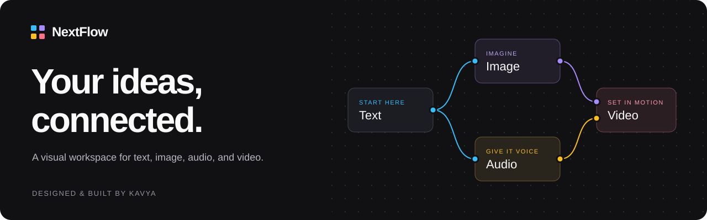
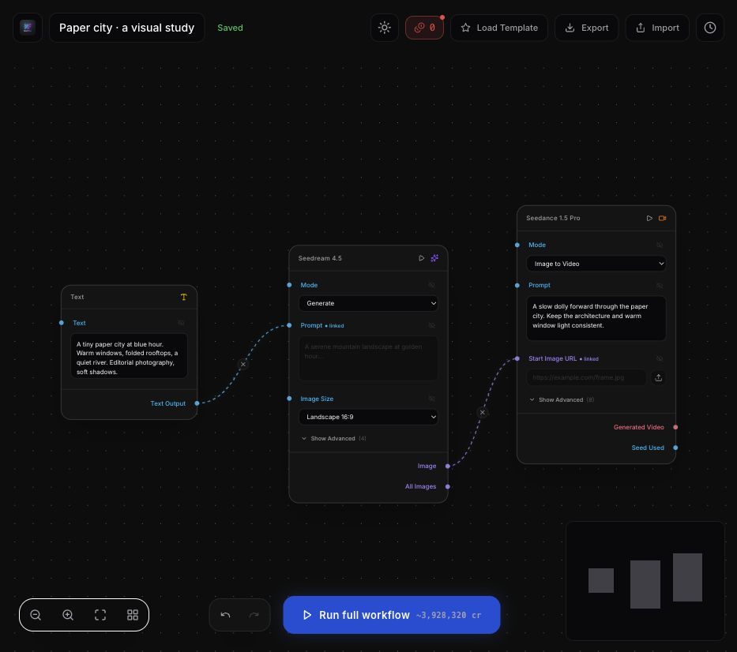
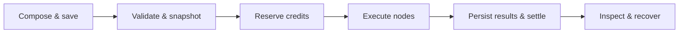

<p align="center">
  
</p>

<p align="center">
  <a href="#inside-the-canvas">The canvas</a> &nbsp; / &nbsp;
  <a href="#run-locally">Run locally</a> &nbsp; / &nbsp;
  <a href="docs/quickstart.mdx">API reference</a> &nbsp; / &nbsp;
  <a href="#where-the-project-stands">Project status</a>
</p>

# NextFlow

A prompt becomes an image. An image becomes a shot. A voice gives it a story.

**NextFlow is a visual workspace for connecting those steps.** Place text, image, audio, and video tools on a canvas, wire their inputs together, and follow the values from one node to the next. The graph stays editable, the runs stay inspectable, and the same idea can take a different path without starting over.

Built and maintained by [Kavya](https://github.com/kavya468).

## Inside the canvas



<sub>A local example graph: a paper-city brief → an image step → a motion step. This is the real editor; the screenshot shows composition, not a completed paid-provider run.</sub>

### Start with an idea. Keep the connections.

Drop in a prompt or a piece of media. Connect the output you need to the next tool's input. Typed ports make the handoff explicit; connected fields show where their values come from. Reuse a template, rearrange the graph, or export it as JSON to pick up later.

### Look inside the run.

Run the whole graph or a selection with its dependencies, then open the history to inspect each step's inputs and outputs. Failed dependencies block their downstream nodes. Completed results remain visible when another branch fails, and recovery checks confirmed worker results before continuing interrupted work.

### Keep the work you have already done.

Autosave checks revisions so a second session cannot silently overwrite a newer draft. A conflict keeps your local work available to export. Before a paid run starts, NextFlow shows the maximum credit reservation; confirmed usage settles once, and uncertain provider outcomes keep their hold until they can be resolved.

## The toolbox

| Bring in | Generate | Shape and assemble |
| --- | --- | --- |
| Text, images, video | Gemini and OpenRouter text | Crop images |
| Connected values from earlier nodes | Seedream images, Seedance video | Extract frames or audio |
| Reusable workflow templates | ElevenLabs dialogue | Merge clips or replace a soundtrack |

The registry contains **15 node types**. Kling editing and lipsync are present in the editor but **execution is disabled** until duration-based billing can be verified. See [billing policy and limits](docs/BILLING_POLICY.md) for the current boundaries.

## Beneath the canvas

Every run starts from a saved graph snapshot. The web app validates the request and reserves credits; a Trigger.dev worker executes the snapshot and records each node's result. The editor reads that persisted state, so a worker completion notification by itself does not establish that billing has settled.



| Area | Implementation |
| --- | --- |
| Application | Next.js App Router, React, TypeScript |
| Editor | React Flow, Zustand, shared UI configuration |
| API and authentication | tRPC, REST/OpenAPI, MCP, Clerk sessions, Unkey API keys |
| Persistence | PostgreSQL, Prisma, transactional credit ledger |
| Background execution | Trigger.dev tasks, provider adapters, FFmpeg |
| Media storage | Signed Transloadit uploads |

## Run locally

Use **Node 24** (the exact version is in `.nvmrc`) and **pnpm 10.33.0**. You also need a separate PostgreSQL database and a Clerk development application. The database adapter supports loopback PostgreSQL for local development and Neon for hosted use.

```bash
git clone https://github.com/kavya468/NextFlow.git
cd NextFlow
cp .env.example .env.local
pnpm install --frozen-lockfile
```

Fill in `.env.local` before starting the app. The example groups credentials by feature; it contains no working keys.

```bash
pnpm db:migrate
pnpm dev
```

Open [localhost:3000](http://localhost:3000) and sign in. `db:migrate` applies checked-in migrations to the configured database; confirm the connection points to your development database first.

Workflow execution also needs a Trigger.dev development worker. Set your project reference in `trigger.config.ts`, configure its development secret, and start it in another terminal:

```bash
pnpm exec trigger.dev login
pnpm exec trigger.dev dev
```

Configure provider credentials in the worker environment for the nodes you use. Media processing needs FFmpeg and FFprobe on `PATH`, plus Transloadit credentials for storing results. Uploads also require Unkey for rate limiting. Fal callbacks need a publicly reachable HTTPS `NEXT_PUBLIC_APP_URL` and the same `FAL_WEBHOOK_SECRET` in the app and worker; localhost alone cannot receive them.

Paid nodes require a funded credit ledger. There is no self-service purchase flow or automatic development credit grant. Start with a Text-to-Text workflow to check dispatch and input propagation without paid providers.

## Working on NextFlow

The project uses TypeScript source throughout the application. Shared interaction copy lives in `lib/ui-config.ts`; visual tokens live in `app/globals.css`. Keep UI changes small and consistent with the existing editor.

<details>
<summary><strong>Checks and test setup</strong></summary>


| Command | Purpose |
| --- | --- |
| `pnpm dev` | Start the development server |
| `pnpm typecheck` | Generate Next.js route types and check TypeScript |
| `pnpm test` | Run unit and mocked integration tests, including native media checks |
| `pnpm test:integration` | Run accounting, recovery, and save-conflict tests against isolated PostgreSQL |
| `pnpm lint` | Report application-wide lint findings |
| `pnpm build` | Generate Prisma client and build the web application |
| `pnpm db:migrate` | Apply checked-in database migrations |

The database tests require a **disposable loopback PostgreSQL database named `nextflow_test`**. They delete their fixtures. Configure `DATABASE_URL` and `DIRECT_URL` explicitly, apply migrations, then run `pnpm test:integration`. Keep these credentials separate from the database used by your browser session.

[CI](.github/workflows/ci.yml) checks types, boundary/test lint, unit tests, PostgreSQL integration tests, and the production build. Full application lint is reported separately while older lint debt is addressed. Native media tests require FFmpeg and FFprobe; CI installs them explicitly.

</details>

<details>
<summary><strong>Find your way around the source</strong></summary>

| Path | Contents |
| --- | --- |
| `app/`, `components/`, `hooks/` | Pages, editor UI, and save coordination |
| `lib/nodes/` | Node contracts, provider mappings, and registry |
| `lib/services/`, `lib/credits/` | Workflow lifecycle, recovery, and accounting |
| `lib/ui-config.ts`, `app/globals.css` | Shared interaction/copy settings and visual tokens |
| `server/trpc/` | Authenticated application and REST procedures |
| `src/trigger/` | Background orchestration and provider/media tasks |
| `prisma/` | Database schema and versioned migrations |
| `lib/__tests__/`, `hooks/__tests__/`, `tests/` | Regression tests and local verification fixtures |
| `docs/` | API reference, billing policy, and README visuals |

Generated JavaScript, Prisma clients, build output, credentials, local agent configuration, and design experiments are excluded from version control.

</details>

## REST and MCP

Generate an API key from **Settings > API Keys**. REST requests use `Authorization: Bearer <key>` and the `/api/v1` prefix:

```bash
curl http://localhost:3000/api/v1/workflows \
  -H "Authorization: Bearer $NEXTFLOW_API_KEY"
```

The generated specification is served at `/api/v1/openapi.json`. Request examples and payload details are in [the API documentation](docs/quickstart.mdx). Execution requests accept an `idempotencyKey`; reuse it with the same request when retrying an uncertain response.

MCP clients connect to `/api/mcp` using HTTP transport and the same bearer API key. The server exposes workflow discovery, graph editing, and execution tools. There is no separate stdio MCP server to install.

## Where the project stands

The web application and Trigger.dev worker share the database schema, task payloads, and accounting contract. Changes to that contract require a coordinated release of both components.

Local tests cover concurrency, recovery, payload validation, save conflicts, and media boundaries. Live paid-provider execution and hosted worker recovery still need end-to-end verification. Existing dependency advisories and application lint debt remain. Completion callbacks are best-effort, without delivery retries or event filtering; poll execution status for confirmation.

Automatic Vercel deployments are enabled for pushes to `main` in `vercel.json`. Feature branches run CI and remain undeployed. A local commit alone does not deploy; it must reach GitHub. Vercel uses the linked Git repository, Node 24, and Corepack with the pinned pnpm version.

Production Vercel builds apply checked-in migrations with `pnpm db:migrate` before building the application. A migration failure stops the build. Preview and local builds do not run this production migration step. Configure `DIRECT_URL` (or `DATABASE_URL`) for the intended production database, and review migrations for compatibility with the application that is still serving traffic.

Trigger.dev workers are deployed separately. When task code or its execution contract changes, deploy the matching worker from the same release with `pnpm exec trigger deploy --env prod`, then verify a Text-to-Text run before testing paid providers. Required environment variables are listed in `.env.example`; keep app and worker configuration in sync.

## Ownership

NextFlow is a personal project built and maintained by [Kavya](https://github.com/kavya468). The source is public for inspection; the project remains proprietary, and publication does not grant an open-source license. Third-party libraries and services retain their respective licenses and terms.
