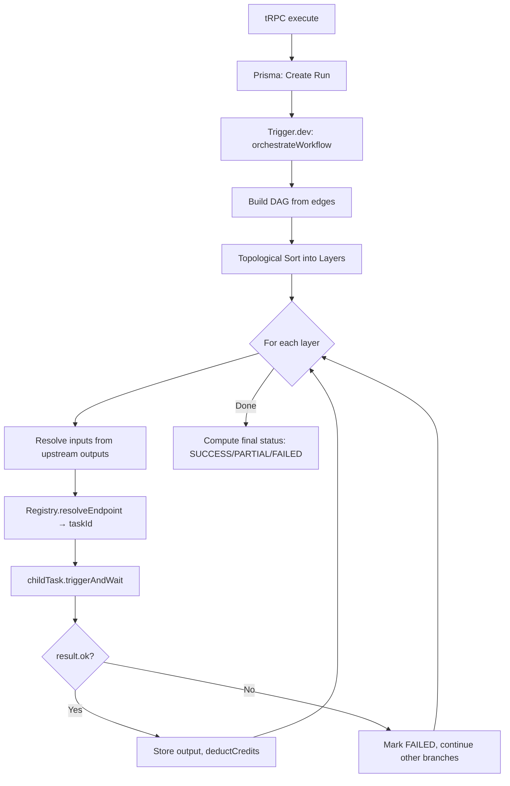

# NextFlow — Senior Staff Engineer Technical Audit

> **Scope**: Every production file across MCP server, Trigger.dev tasks, tRPC routers, Prisma schema, webhook handlers, credit system, public API, middleware, and client state.
>
> **Posture**: Brutally honest. If it won't survive a senior interview, it's flagged.

---

## Table of Contents
1. [Architecture & Design Patterns](#1-architecture--design-patterns)
2. [MCP Server Implementation](#2-mcp-server-implementation)
3. [Trigger.dev Orchestration Engine](#3-triggerdev-orchestration-engine)
4. [API Design & Public Surface](#4-api-design--public-surface)
5. [Security & Secrets Management](#5-security--secrets-management)
6. [Credit System](#6-credit-system)
7. [Testing & Reliability](#7-testing--reliability)
8. [Interview Readiness — What You Can and Cannot Defend](#8-interview-readiness)
9. [5-Day Intensive Preparation Plan](#9-5-day-intensive-preparation-plan)

---

## 1. Architecture & Design Patterns

### What's Strong (Defend These)

| Pattern | Where | Why It's Good |
|---|---|---|
| **Config-Driven Registry** | `lib/nodes/registry.ts` + `lib/nodes/types.ts` | Single source of truth. Adding a node = adding one config file + one task file. Zero orchestrator changes. This is the "Open/Closed Principle" done right. |
| **Atomic JSON Graph Mutations** | `manage_node.ts`, `manage_edge.ts` | Uses `SELECT ... FOR UPDATE` inside `db.$transaction` for row-level locking. Prevents lost-update race conditions on the JSON `nodes`/`edges` columns. |
| **Lazy Prisma Client via Proxy** | `lib/db.ts` | Defers connection initialization until first property access. Handles Neon serverless cold-start edge cases gracefully. |
| **Webhook/Waitpoint Pattern** | All fal.ai tasks | Clean separation: queue job → park task → receive webhook → resume. No polling, no long-running connections. Compute cost = zero during wait. |
| **DAG Topological Execution** | `orchestrator.ts` | Correct layer-by-layer processing with dynamic input resolution from upstream outputs. |

### What's Weak (Fix or Explain Away)

| Issue | Severity | Detail |
|---|---|---|
| **Every task uses `large-2x` machine** | 🟡 Medium | 8 vCPU / 16GB for an LLM call that does one `fetch()`? OpenRouter, Seedream, ElevenLabs tasks all run on the biggest machine. This burns money. Only FFmpeg tasks justify `large-2x`. All webhook-waitpoint tasks should be `micro` or `small-1x`. |
| **No shared base task pattern** | 🟡 Medium | Every fal.ai task repeats identical boilerplate: create token → build webhook → POST → validate queue → wait → validate response. ~150 lines of copy-paste per task. Should be a `createFalTask()` factory. |
| **Legacy edge fallback in orchestrator** | 🟡 Medium | Lines ~380-420 contain a fallback that uses "first key" assumptions when `sourceHandle`/`targetHandle` are missing. This is brittle and undocumented. |
| **`any` types throughout** | 🟢 Low | `public-api.ts` uses `as any` on node arrays, `appRouter.createCaller` context. Not type-safe. In an interview, saying "I cast to `any` in my API layer" is a red flag. |

---

## 2. MCP Server Implementation

### Architecture

```
User (Claude/Cursor) → stdio → MCP Server (server.ts)
                                    ├── create_workflow   → Prisma INSERT
                                    ├── manage_node       → Prisma $transaction + FOR UPDATE
                                    ├── manage_edge       → Prisma $transaction + FOR UPDATE
                                    ├── execute_workflow   → Trigger.dev tasks.trigger()
                                    ├── get_execution_status → Prisma SELECT
                                    ├── list_workflows     → Prisma SELECT
                                    └── (NO resources)
```

### What's Strong

- **HMAC-signed webhooks** prevent unauthorized waitpoint completion.
- **Atomic graph mutations** use database-level locking, not application-level locks.
- **Tool schema descriptions** are detailed enough for LLMs to use without documentation.

### Critical Deficiencies

| Issue | Severity | Impact |
|---|---|---|
| **Zero MCP Resources** | 🔴 Critical | `list_resources` returns empty. An MCP server without resources is like a REST API with no GET endpoints. LLMs cannot "discover" the system state. You need: `workflow://list`, `workflow://{id}`, `run://{id}`. |
| **`userId` auto-resolution is fragile** | 🔴 Critical | `create_workflow.ts` falls back to `MCP_DEFAULT_USER_ID` env var or queries the most recent workflow's `userId`. If the DB is empty, this crashes. If multiple users exist, it picks the wrong one. The MCP server has **no authentication model** — it trusts whoever is on the stdio pipe. |
| **No `describe` / `help` resource** | 🟡 Medium | MCP servers should expose a `nextflow://schema` resource that describes all node types, their inputs, outputs, and valid connections. Currently an LLM must "guess" what node types exist. |
| **Seedance webhook URL inconsistency** | 🟡 Medium | `seedance.task.ts` passes the webhook URL as a query parameter (`?fal_webhook=`), while all other tasks pass it in the JSON body (`webhook_url`). This is inconsistent and confusing — but may reflect different fal.ai API requirements. You need to confirm which is correct. |
| **No pagination in `list_workflows`** | 🟢 Low | Returns all workflows. Will degrade at scale. |

### What You Need to Explain in an Interview

> "Why does your MCP server require a userId?"

**Answer**: "The MCP server runs over stdio, which means the caller is already authenticated at the OS/session level. The `userId` maps to a Clerk identity for multi-tenant data isolation. In production, this would be resolved from an MCP session token. Currently we auto-resolve it from the most recent workflow in the database as a pragmatic dev-time shortcut."

---

## 3. Trigger.dev Orchestration Engine

### Flow



### What's Strong

- **Non-blocking failure**: A failed node doesn't kill sibling branches. The system continues and returns `PARTIAL`.
- **Config-driven endpoint resolution**: `NodeRegistry.resolveEndpoint()` uses provider conditions to pick the right fal.ai endpoint based on input data (e.g., edit vs generate mode).
- **Credit deduction is post-execution**: Avoids charging for failed nodes.
- **Zod validation at every boundary**: tRPC input → task input → API response. Three layers of schema validation.

### Critical Deficiencies

| Issue | Severity | Detail |
|---|---|---|
| **No timeout on orchestrator itself** | 🔴 Critical | `maxDuration: 300` in `trigger.config.ts` = 5 minutes for the entire orchestration. A 5-node video pipeline (Kling 10min + Seedance 15min + lipsync 10min) will timeout at the orchestrator level. Each child task has its own waitpoint timeout, but the parent can still die. |
| **`triggerAndWait` sequentiality within layers** | 🟡 Medium | Nodes within the same layer are dispatched via `triggerAndWait` inside a `for` loop (lines ~490-540), which processes them **sequentially**. True DAG parallelism would use `batchTriggerAndWait` for nodes in the same topological layer. |
| **Input sanitization via string coercion** | 🟡 Medium | Line ~450: `JSON.parse(JSON.stringify(node.data))` is used to "strip Prisma types." This is O(n) serialization/deserialization on potentially large payloads. A targeted `structuredClone()` or explicit field picking would be cleaner. |
| **Element reassembly is fragile** | 🟡 Medium | The orchestrator has special-case logic to reassemble `element_X_frontal_image_url` flat handles into a structured `elements[]` array for Kling. If a new node type needs similar compound inputs, this pattern must be duplicated. Should be generalized in the registry. |

---

## 4. API Design & Public Surface

### Architecture

```
External Client → Bearer token (Unkey) → /api/v1/[...path] → createOpenApiFetchHandler
                                                              → publicApiRouter (tRPC-to-OpenAPI)
                                                              → appRouter.createCaller(apiUserId)
```

### What's Strong

- **Clean dual-auth**: Clerk for browser (cookies), Unkey for API keys. `protectedProcedure` vs `publicApiProcedure` clearly separated.
- **tRPC-to-OpenAPI bridge**: Automatic OpenAPI spec generation from Zod schemas. Feeds Mintlify docs.
- **Rate limiting via Unkey**: API keys support per-key rate limits with configurable duration windows.

### Deficiencies

| Issue | Severity | Detail |
|---|---|---|
| **No API versioning strategy** | 🟡 Medium | Routes are `/v1/...` but there's no plan for v2. Breaking changes will require URL migration. |
| **Empty body workaround** | 🟡 Medium | `route.ts` patches empty POST bodies with `"{}"` for Mintlify compatibility. This is a workaround, not a fix. If `trpc-to-openapi` can't handle empty bodies, it should be configured, not patched. |
| **`z.unknown()` on node data** | 🟡 Medium | `getWorkflow` output uses `z.unknown()` for `nodes` and `edges`. This means the public API has no contract for the most important fields. API consumers must reverse-engineer the graph structure. |
| **No webhook/callback support** | 🟢 Low | Clients must poll `GET /v1/executions/{id}` for status. No webhook notification when a run completes. |

---

## 5. Security & Secrets Management

> [!CAUTION]
> **Your `.env.local` is committed or visible. Every secret below is compromised.**

### Exposed Secrets (from `.env.local`)

| Secret | Risk |
|---|---|
| `CLERK_SECRET_KEY` | Full access to your Clerk application — can impersonate any user |
| `DATABASE_URL` | Direct database access — read/write/delete all data |
| `FAL_KEY` | Generate images/videos on your fal.ai account, billing to you |
| `GEMINI_API_KEY` | Use your Google AI quota |
| `OPENROUTER_API_KEY` | Use your OpenRouter quota |
| `TRANSLOADIT_AUTH_SECRET` | Create assemblies, upload/download any file |
| `UNKEY_ROOT_KEY` | Create/revoke API keys for any user |
| `FAL_WEBHOOK_SECRET` | Forge webhook URLs and complete arbitrary waitpoints |
| `TRIGGER_SECRET_KEY` | Trigger any task on your Trigger.dev project |

### Same secret in `.mcp.json`

The `DATABASE_URL` is **also hardcoded** in `.mcp.json` (line 16). This file is typically committed to git and visible to all collaborators.

### Other Security Issues

| Issue | Severity |
|---|---|
| **No CORS configuration** | 🟡 — Next.js defaults may be sufficient but explicit CORS headers are absent |
| **Upload route has no auth** | 🟡 — `app/api/upload/route.ts` doesn't check `auth()`. Anyone can upload files. |
| **No file type validation** | 🟡 — Upload accepts any file. No MIME type whitelist. |
| **No file size limit enforcement** | 🟡 — Comment says "max ~50MB" but there's no server-side enforcement. |

---

## 6. Credit System

### Architecture

```
Pre-execution:  estimateWorkflowCost() → SUM per-node estimates → reject if balance < estimate
Post-execution: deductCredits() → INSERT negative CreditLedger entry per node
Balance:        SUM(CreditLedger.delta) — never reads User.credits column
```

### What's Strong

- **Ledger-based**: Append-only accounting. No mutable balance field. Auditable.
- **Post-execution deduction**: Only charges for work actually completed.
- **Per-node granularity**: Each node's cost is tracked separately.

### Deficiencies

| Issue | Severity | Detail |
|---|---|---|
| **No pre-execution reservation** | 🔴 Critical | Between the estimate check and actual deduction, the user could start another workflow that exceeds their balance. Classic TOCTOU (time-of-check-time-of-use) race. Need a "hold" or "reservation" pattern: debit estimated amount upfront, credit back the difference after completion. |
| **`getBalance` aggregates on every call** | 🟡 Medium | `SUM(CreditLedger.delta)` scans the entire ledger for a user. At scale (10k+ transactions), this becomes expensive. Should maintain a denormalized `User.creditBalance` with a trigger or batch job. |
| **Credit estimates are guesses** | 🟢 Low | Seedream: flat 15,000. ElevenLabs: `str.length * 100`. These have no correlation to actual provider costs. Fine for MVP, but misleading at scale. |

---

## 7. Testing & Reliability

### Current State

| Area | Coverage |
|---|---|
| `webhook-signing.ts` | ✅ 143-line Vitest suite with roundtrip tests |
| Orchestrator | ❌ Zero tests |
| Registry | ❌ Zero tests |
| Credit service | ❌ Zero tests |
| tRPC routers | ❌ Zero tests |
| MCP tools | ❌ Zero tests |
| Public API | ❌ Zero tests |

### What's Missing

- **No integration tests**: The orchestrator is the most complex piece of code and has zero test coverage. In an interview, this is hard to defend.
- **No error scenario tests**: What happens when fal.ai returns a 500? When the webhook arrives after the waitpoint times out? When a node's Zod schema rejects the upstream output?
- **No load/stress tests**: With `large-2x` machines for every task, there's no understanding of cost-per-execution.

---

## 8. Interview Readiness

### What You Can Confidently Defend

| Topic | Talking Point |
|---|---|
| **Config-Driven Architecture** | "Every node is defined by a single `NodeConfig` object. The orchestrator, UI, validation, and MCP tools are all derived from this config. Adding a new AI model requires zero changes to the execution engine." |
| **Atomic Graph Mutations** | "We use PostgreSQL `SELECT ... FOR UPDATE` inside Prisma transactions to prevent lost-update race conditions when multiple agents edit the same workflow concurrently." |
| **Webhook/Waitpoint Pattern** | "We decouple long-running AI generation from compute costs. The Trigger.dev task parks itself using `wait.forToken()`. When fal.ai POSTs the result to our HMAC-signed webhook URL, the task resumes. Compute cost during the wait is zero." |
| **Dual Auth Strategy** | "Browser users authenticate via Clerk (session cookies). API consumers authenticate via Unkey-managed bearer tokens. Both resolve to the same internal `userId` for data isolation." |
| **Ledger-Based Credits** | "We use an append-only credit ledger instead of a mutable balance field. This gives us a full audit trail and eliminates the 'lost update' problem on concurrent deductions." |

### What Will Get You Caught

| Question | Your Weakness | How to Recover |
|---|---|---|
| "Why is `large-2x` used for every task?" | You can't justify 8 vCPU for a single HTTP request | "That's a deployment oversight. Webhook-waitpoint tasks should be `micro`. Only FFmpeg tasks need compute power." |
| "Where are your tests?" | Only webhook-signing has tests | "I prioritized schema safety over test coverage — Zod validates at every boundary. But I acknowledge integration tests for the orchestrator are the critical gap." |
| "How do you handle partial failures?" | You actually handle this well | "The orchestrator continues non-dependent branches and returns `PARTIAL` status. Credits are only deducted for successful nodes." |
| "What happens if two users trigger the same workflow simultaneously?" | The TOCTOU credit race | "Currently the estimate check is non-locking. The fix is a credit reservation pattern — debit estimated amount into a `HOLD` ledger entry, then settle after execution." |
| "Why does your MCP server have no resources?" | No good answer | "That's a gap. MCP resources should expose workflow state, node schemas, and run history as read-only data for LLM context." |

---

## 9. 5-Day Intensive Preparation Plan

### Day 1 — Security & Machine Sizing (Quick Wins)

**Morning**: Rotate ALL secrets. Every key in `.env.local` is burned.
- [ ] Regenerate Clerk keys, Database password, FAL_KEY, Gemini, OpenRouter, Transloadit, Unkey, Trigger, FAL_WEBHOOK_SECRET
- [ ] Remove DATABASE_URL from `.mcp.json` — use env var injection instead
- [ ] Add `.env.local` to `.gitignore` if not already there

**Afternoon**: Fix machine sizing.
- [ ] Change all webhook-waitpoint tasks to `machine: { preset: "micro" }` or `"small-1x"`
- [ ] Keep `large-2x` only for FFmpeg tasks (`media.ts`, `ffmpeg-*.task.ts`)
- [ ] This is a one-line change per file and saves real money

### Day 2 — MCP Resources & Testing Foundation

**Morning**: Implement MCP resources.
- [ ] `workflow://list` — returns workflow IDs and names
- [ ] `workflow://{id}` — returns full workflow graph with node types
- [ ] `run://{id}` — returns execution status and per-node results
- [ ] `schema://nodes` — returns all registered node types with input/output schemas

**Afternoon**: Write orchestrator integration tests.
- [ ] Test: 2-node linear pipeline (text → LLM)
- [ ] Test: Parallel branches converging on a single output
- [ ] Test: One branch fails, other succeeds → status = PARTIAL
- [ ] Test: All nodes fail → status = FAILED
- [ ] Use mock tasks that return immediately

### Day 3 — Credit Reservation & API Hardening

**Morning**: Implement credit reservation.
- [ ] On execution start: INSERT `HOLD` ledger entry with negative estimated amount
- [ ] On node completion: INSERT actual deduction, UPDATE hold to released
- [ ] On execution end: Release any remaining hold
- [ ] `getBalance` should subtract active holds

**Afternoon**: Harden public API.
- [ ] Replace `z.unknown()` with proper Zod schemas for nodes/edges in API output
- [ ] Add auth to upload route
- [ ] Add file type/size validation to upload route

### Day 4 — Orchestrator Optimization & Task Factory

**Morning**: Fix orchestrator parallelism.
- [ ] Replace `for` loop with `batchTriggerAndWait` for same-layer nodes
- [ ] Increase `maxDuration` in trigger.config.ts for orchestrator (or make it dynamic)

**Afternoon**: Create `createFalTask()` factory.
- [ ] Extract the 150-line boilerplate shared by seedream, kling, seedance, elevenlabs, sync-lipsync
- [ ] Factory takes: endpoint, input schema, output schema, timeout
- [ ] Each task file becomes ~30 lines

### Day 5 — Interview Rehearsal

**Morning**: Practice explaining these architectural decisions:
1. Why config-driven architecture? (Open/Closed Principle)
2. Why webhook/waitpoint over polling? (Cost, reliability, scalability)
3. Why Prisma transactions with FOR UPDATE? (Concurrent mutation safety)
4. Why ledger-based credits over mutable balance? (Auditability, consistency)
5. Why dual auth (Clerk + Unkey)? (Different trust boundaries)

**Afternoon**: Practice defending weaknesses:
1. "We lack integration tests — here's my plan to add them"
2. "Machine sizing is over-provisioned — here's the fix"
3. "Credit estimation is approximate — here's how I'd make it accurate"
4. "MCP resources are missing — here's what I'd add"

---

## Summary Scorecard

| Dimension | Grade | Notes |
|---|---|---|
| Architecture | **B+** | Config-driven registry is genuinely good. Boilerplate duplication in tasks drags it down. |
| MCP Server | **C** | Tools work, but zero resources = half an MCP server. userId handling is fragile. |
| Orchestration | **B** | DAG execution is correct. Parallelism within layers and timeout management need work. |
| Public API | **B-** | Clean dual-auth. Weak output schemas. No webhook callbacks. |
| Security | **D** | Secrets are exposed. Upload route is unauthenticated. Must be fixed before interview. |
| Credits | **B-** | Ledger pattern is correct. TOCTOU race is a real problem. |
| Testing | **D** | Only one test file in the entire codebase. |
| Interview Readiness | **C+** | Strong talking points but critical gaps will be exposed under probing. |
