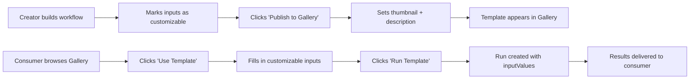

# Template Gallery — Product Design

## The Vision

Published workflows appear as browsable, runnable templates — just like Krea's Examples tab. Users discover templates, fill in the exposed inputs, and hit "Run" without ever touching the workflow editor.

## Screen Flow

````carousel

<!-- slide -->

````

## How It Maps to Your Architecture

| UX Element | Backend Source |
|-----------|---------------|
| Template cards in gallery | `Workflow` records where `visibility = "published"` |
| Category filter tabs (Image/Video/Audio) | Derived from the workflow's node types (has Seedream → "Image") |
| "Customize Inputs" form fields | `getExposedInputs()` — the function you already built |
| "Run Template →" button | Calls `execute_workflow` with `inputValues` — already built |
| "15k uses" stat | `COUNT(Run) WHERE workflowId = X` |
| Creator name & avatar | `Workflow.user` relation → Clerk profile |

**The key insight: 90% of the backend for this feature already exists.** Your parameterized execution work is the foundation. The gallery is just a UI layer on top.

## Data Model Changes Needed

```prisma
model Workflow {
  // ... existing fields ...
  visibility  String   @default("private")  // "private" | "published" | "unlisted"
  thumbnail   String?                        // CDN URL for gallery card image
  category    String?                        // "image" | "video" | "audio" | "text"
  usageCount  Int      @default(0)           // Denormalized run count for sorting
  publishedAt DateTime?                      // When it was published
}
```

## The Three Screens

### 1. Gallery Page (`/templates`)
- Grid of template cards
- Filter tabs: All / Image / Video / Audio / Text
- Search bar
- Sort by: Popular, Recent, Most Used
- Each card shows: thumbnail, title, description, creator, usage count, "Use Template" button

### 2. Template Detail Modal (or page)
- Large preview image/video
- Template metadata (creator, description, usage stats)
- **"Customize Inputs" form** — dynamically generated from `getExposedInputs()`
  - Text inputs → text fields pre-filled with defaults
  - Image inputs → upload dropzone
  - Video inputs → upload dropzone or URL field
- **"Run Template →"** button — calls execute with the form values
- **"View Workflow"** button — opens the editor in read-only mode (optional)

### 3. Publish Flow (from the Editor)
Creator side — when a user wants to publish their workflow:
1. Click "Publish" in the editor toolbar
2. Side panel opens showing:
   - Thumbnail upload
   - Title & description
   - Category selector
   - Preview of which inputs consumers will see (from exposed nodes)
3. Click "Publish to Gallery"
4. Workflow gets `visibility: "published"` + `publishedAt: now()`

## User Journey



## Security Model (Why It's Safe)

| What consumers CAN do | What consumers CANNOT do |
|----------------------|------------------------|
| See the template card (thumbnail, title, description) | See the internal node graph |
| Fill in exposed input fields | Modify any non-exposed node values |
| Run the template with their own values | See API keys or internal configuration |
| View their own run results | Access the creator's other workflows |
| Like/bookmark templates | Modify the workflow template itself |

The consumer interacts with the **interface** (exposed inputs). The **implementation** (the graph, the API keys, the node configs) is never visible. This is the same security model as Google Forms — you can fill out a form without seeing the spreadsheet formula behind it.

## Interview Framing

When asked about this feature:

> *"We have a template marketplace similar to Krea's Examples tab. Creators build workflows, mark specific inputs as customizable, and publish them. Consumers browse by category, fill in a simple form, and hit Run. Under the hood, each run creates an isolated execution with the consumer's values mapped to the exposed passthrough nodes. The workflow template is immutable — consumers never see or modify the internal graph. Credits are deducted from the consumer's account, not the creator's. This gives us a two-sided marketplace: creators monetize their pipeline expertise, consumers get production-ready AI workflows without building anything."*
